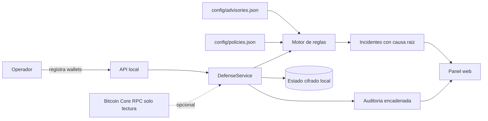

# 01 · Descripción general del sistema

RootCause Bitcoin Defense es una aplicación local que responde a una pregunta
que ninguna wallet responde: **¿de dónde vino esta clave y se puede demostrar?**

---

## 1 · Qué es

Un servidor HTTP que corre en la máquina del usuario, sirve un panel web en
`http://127.0.0.1:8787` y evalúa un inventario de wallets contra una matriz de
avisos de seguridad de fabricantes.

| Característica | Valor comprobado |
| --- | --- |
| Tipo | Aplicación de escritorio local con interfaz web (PWA instalable) |
| Lenguaje | JavaScript ESM sobre Node.js ≥ 22.12 |
| Dependencias de terceros | **Cero** — verificado por `scripts/check-local-only.js` |
| Superficie de red saliente | Solo Bitcoin Core por RPC, y solo si se configura |
| Persistencia | Archivo local cifrado con AES-256-GCM, o memoria en modo demostración |
| Licencia | MIT |
| Distribución | ZIP portable e instalador `.exe` para Windows x64, más contenedor Docker |

**No es una wallet.** No custodia claves, no firma, no transmite y rechaza
activamente cualquier material secreto que se le envíe
(`src/domain/secret-guard.js`).

---

## 2 · Qué problema resuelve

En julio y agosto de 2026, un defecto en la generación de entropía de ciertos
firmwares COLDCARD permitió reconstruir semillas creadas con esas versiones. El
protocolo Bitcoin no falló: las transacciones del atacante eran perfectamente
válidas y firmadas con la clave legítima.

Eso deja un hueco que el resto de herramientas no cubre:

| Pregunta | ¿Quién la responde hoy? |
| --- | --- |
| ¿Cuánto saldo tengo? | Cualquier wallet |
| ¿Está mi dispositivo actualizado? | El propio dispositivo |
| **¿Con qué firmware nació la semilla que uso?** | **Nadie — y no se ve mirando la wallet** |
| ¿Ese firmware está en un aviso publicado? | Requiere cruzar inventario con avisos |

Actualizar el firmware **no repara una semilla ya generada**. Por eso el objeto
que este sistema inventaría no es el saldo: es la **procedencia criptográfica**
de cada clave.

---

## 3 · A quién está dirigido

| Actor | Qué obtiene |
| --- | --- |
| Titular de custodia propia | Saber si alguna de sus semillas nació con firmware afectado |
| Tesorería o pequeña empresa | Detectar concentración de fondos en una sola clave y quorums frágiles |
| Respondedor de incidentes | Hallazgos con causa raíz, evidencia y runbook de migración |
| Auditor | Registro encadenado por hash y un informe de auditoría en 14 etapas reproducible |
| Desarrollador | Un producto de seguridad completo, sin dependencias, auditable de principio a fin |

No hay usuarios, roles ni sesiones dentro del sistema: **un único operador
local**. El modelo de seguridad depende de eso (ver
[`11-security.md`](11-security.md)).

---

## 4 · Casos de uso principales

| # | Caso de uso | Punto de entrada |
| ---: | --- | --- |
| 1 | Registrar una wallet con la procedencia de sus firmantes | `POST /api/wallets` |
| 2 | Ejecutar un análisis de riesgo sobre todo el inventario | `POST /api/scan` |
| 3 | Ver el panorama de riesgo, saldo vigilado y estado del nodo | `GET /api/summary` |
| 4 | Consultar y reconocer incidentes | `GET /api/incidents`, `PATCH /api/incidents/{id}` |
| 5 | Auditar la postura de la propia instalación | `GET /api/posture` |
| 6 | Registrar la aprobación de un hash de transacción | `POST /api/approvals` |
| 7 | Observar un gasto y correlacionarlo con las aprobaciones | `POST /api/observe/transaction` |
| 8 | Tomar un snapshot de Bitcoin Core | `POST /api/node/refresh` |
| 9 | Verificar la integridad de la cadena de auditoría | `GET /api/audit` |
| 10 | Ejecutar la auditoría de custodia en 14 etapas | `node scripts/audit-bitcoin.js --report` |

---

## 5 · Funcionalidades principales

- **Inventario watch-only** de wallets y firmantes: solo huellas, fabricante,
  modelo, firmware al crear la semilla y origen de la entropía.
- **Motor de 26 reglas** en siete familias, que produce hallazgos con causa raíz
  declarada, evidencia y pasos de remediación.
- **Matriz de avisos versionada** (`config/advisories.json`) con fecha de
  verificación, y una regla que avisa cuando esa fecha envejece.
- **Autoauditoría de la instalación**: ocho controles que miran cómo está
  desplegada la propia herramienta, no solo las claves del usuario.
- **Watchtower** opcional que consulta el nodo y reevalúa periódicamente.
- **Registro de auditoría encadenado por hash**, con verificación de integridad.
- **Persistencia cifrada** AES-256-GCM con escritura atómica.
- **Cliente RPC de solo lectura** con allowlist de 11 métodos.

---

## 6 · Flujo general de funcionamiento

**En palabras, sin depender del diagrama:** el operador registra en el panel qué
wallets tiene y con qué dispositivos y firmware se crearon sus semillas. Ese
inventario se guarda cifrado en la máquina. Cada vez que cambia algo —y también
cuando se pulsa «Analizar»— el motor cruza el inventario con la matriz de avisos
y con la política, y produce una lista de hallazgos. Cada hallazgo se convierte
en un incidente con historial. Opcionalmente, un nodo Bitcoin Core local aporta
datos de la red por una conexión de solo lectura. Todo lo que ocurre se anota en
un registro encadenado por hash que después se puede verificar.

---

## 7 · Entradas y salidas

| Dirección | Qué | Origen o destino |
| --- | --- | --- |
| Entrada | Inventario de wallets y firmantes | Operador, por el panel o la API |
| Entrada | Aprobaciones de hash de transacción | Operador |
| Entrada | Eventos de gasto observado y de privacidad | Operador, watchtower o laboratorio |
| Entrada | Matriz de avisos y política | Archivos versionados en `config/` |
| Entrada | Estado de la cadena | Bitcoin Core, RPC de solo lectura, opcional |
| Salida | Incidentes con causa raíz y remediación | Panel web y API |
| Salida | Puntuación de riesgo agregada | Panel web y API |
| Salida | Registro de auditoría verificable | API `GET /api/audit` |
| Salida | Informe de auditoría en 14 etapas | Archivo Markdown en la raíz del repositorio |
| Salida | Estado cifrado | `data/state.enc.json` |

**Nunca entra:** semilla, mnemónico, passphrase BIP-39, WIF, xprv o tprv. La
petición se rechaza con `422 SECRET_MATERIAL_REJECTED`.

---

## 8 · Componentes más importantes

| Componente | Archivo | Responsabilidad |
| --- | --- | --- |
| Motor de reglas | `src/domain/rule-engine.js` | 18 reglas de custodia, gasto, nodo, privacidad e inteligencia |
| Postura de despliegue | `src/domain/posture.js` | 8 reglas sobre la propia instalación |
| Guardia de secretos | `src/domain/secret-guard.js` | La frontera que define el producto |
| Servicio de defensa | `src/services/defense-service.js` | Validación, persistencia, reevaluación y auditoría |
| Capa HTTP | `src/app.js` | Cabeceras de seguridad, límites y protección de mutaciones |
| Cliente RPC | `src/infrastructure/bitcoin-rpc.js` | Allowlist de lectura y rechazo de destinos remotos |
| Almacén cifrado | `src/infrastructure/encrypted-store.js` | AES-256-GCM con escritura atómica |
| Auditoría | `src/infrastructure/audit-log.js` | Cadena de hashes verificable |

Detalle exhaustivo en [`04-code-map.md`](04-code-map.md).

---

## 9 · Tecnologías y dependencias

| Capa | Tecnología | Nota |
| --- | --- | --- |
| Runtime | Node.js ≥ 22.12 | `engines` en `package.json`; se distribuye embebido en el paquete de Windows |
| Servidor HTTP | `node:http` | Sin Express ni framework |
| Criptografía | `node:crypto` | AES-256-GCM y SHA-256 |
| Frontend | HTML, CSS y JavaScript de módulo | Sin build, sin framework, sin CDN |
| Gestor de paquetes | pnpm 11.19.0 | Declarado, pero **no instala nada**: no hay dependencias |
| Contenedor | `node:24-alpine` | Solo lectura, sin privilegios, usuario 1000 |
| CI | GitHub Actions | 5 workflows, actions pinneadas a SHA |

La ausencia de dependencias no es casual: es un claim verificado en cada build.
El razonamiento está en [`../JAVASCRIPT_PARA_ROOTCAUSE.md`](../JAVASCRIPT_PARA_ROOTCAUSE.md).

---

## 10 · Límites del sistema

| El sistema **sí** | El sistema **no** |
| --- | --- |
| Detecta procedencia de clave declarada contra avisos | Determina la entropía real de una semilla mirando una dirección |
| Correlaciona gasto observado con aprobaciones registradas | Impide un gasto: quien tiene la clave firma fuera de la aplicación |
| Explica la causa raíz y da el runbook | Revierte una transacción Bitcoin confirmada |
| Audita su propia postura de despliegue | Sustituye una auditoría criptográfica o un HSM |
| Verifica la integridad de su registro | Impide que alguien con acceso al equipo reescriba el archivo entero |

La lista completa y sin adornos está en
[`../LIMITACIONES.md`](../LIMITACIONES.md) y en
[`../DETECCION_AMENAZAS.md`](../DETECCION_AMENAZAS.md).

---

## 11 · Integraciones externas

| Integración | Tipo | Obligatoria |
| --- | --- | --- |
| Bitcoin Core | JSON-RPC de solo lectura sobre HTTP | No |
| Node.js Security WG | Descarga de la base de vulnerabilidades, solo en auditoría | No |
| `nodejs.org/dist` | Descarga del runtime, solo al empaquetar | Solo para construir |
| GitHub Actions | CI, CodeQL, auditoría, Pages y releases | Solo para el proyecto |

**En tiempo de ejecución normal, el sistema no habla con nadie salvo el nodo
local que se le configure.** Ninguna de las integraciones anteriores es
necesaria para que la aplicación arranque y detecte.

---

## 12 · Estado observado del repositorio

| Indicador | Valor |
| --- | --- |
| Pruebas | 69, todas pasando (`node --test`) |
| Validadores del repositorio | 7, todos en verde |
| Invariantes de seguridad verificados en marcha | 20 |
| Reglas implementadas y documentadas | 26 de 26 |
| Documentos Markdown en el repositorio | 85 |
| Commits en el histórico | 9 |
| Versiones publicadas | `v0.2.0`, `v0.3.0` |

---

## 13 · El sistema explicado para una persona no técnica

Imagina que tienes una caja fuerte y que la llave se fabricó en una fábrica
concreta, un día concreto, con una máquina concreta. Un día se publica que
aquella máquina, durante unos meses, cortaba las llaves siguiendo un patrón
predecible. Cualquiera que lo sepa puede fabricar una copia de tu llave sin
tocar tu caja fuerte, sin forzarla y sin dejar rastro. Y cuando la abra, la
cerradura no notará nada raro: es la llave correcta.

Con las claves de Bitcoin pasa exactamente eso. Una «semilla» es la llave
maestra, y la fabrica un aparato con un programa dentro. Si ese programa tenía
un fallo cuando se creó tu semilla, tu dinero está expuesto **aunque el aparato
esté guardado en un cajón y desconectado desde hace años**.

Aquí está el problema práctico: mirar tu monedero no te dice nada. El saldo se
ve bien, las direcciones se ven bien, el aparato se ve bien. La única forma de
saberlo es acordarse de **con qué aparato, qué modelo y qué versión de programa
se creó cada llave**, y comparar eso con la lista de fallos publicados.

Este programa hace justo eso, y nada más:

1. Apuntas qué monederos tienes y con qué aparato y versión nació cada llave.
   **Nunca le das la llave** — si intentas dársela, la rechaza.
2. Compara esa lista con los avisos publicados por los fabricantes.
3. Si algo coincide, te lo dice: qué monedero, por qué es un problema y qué
   pasos dar, en orden.
4. Además revisa cosas parecidas: si tienes mucho dinero dependiendo de una sola
   llave, si tu esquema de varias llaves necesita todas para funcionar (perder
   una lo bloquea todo para siempre), o si la lista de avisos lleva demasiado
   tiempo sin revisarse.

Lo que **no** hace, y conviene entenderlo antes de instalarlo: no mueve dinero,
no firma nada, no puede deshacer un pago ya hecho y no puede impedir que alguien
que ya tenga tu llave la use. Es un **diagnóstico**, no un cerrojo. Sirve para
enterarte a tiempo y saber qué hacer, no para que otro lo haga por ti.

Y una advertencia que el propio programa se aplica: si te enseña la pantalla en
verde pero la lista de avisos lleva meses sin actualizarse, ese verde no
significa «estás bien», significa «no he mirado nada nuevo». Por eso el programa
te avisa también de eso.

---

| Siguiente | |
| --- | --- |
| Cómo instalarlo y ejecutarlo | [`02-installation-and-execution.md`](02-installation-and-execution.md) |
| Cómo está construido | [`03-architecture.md`](03-architecture.md) |
| Volver al índice | [`README.md`](README.md) |
