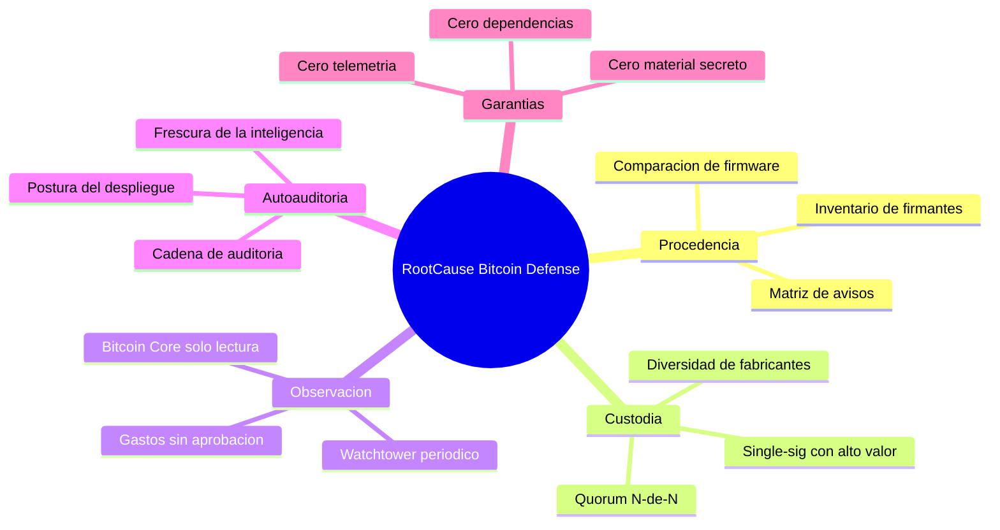
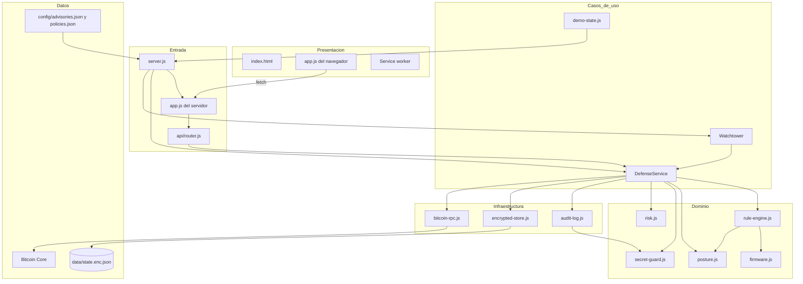
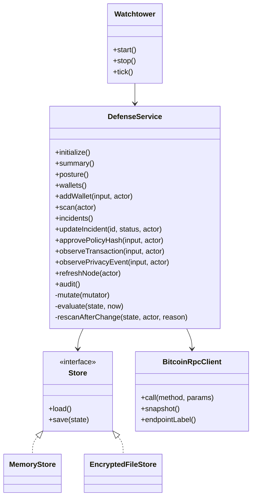
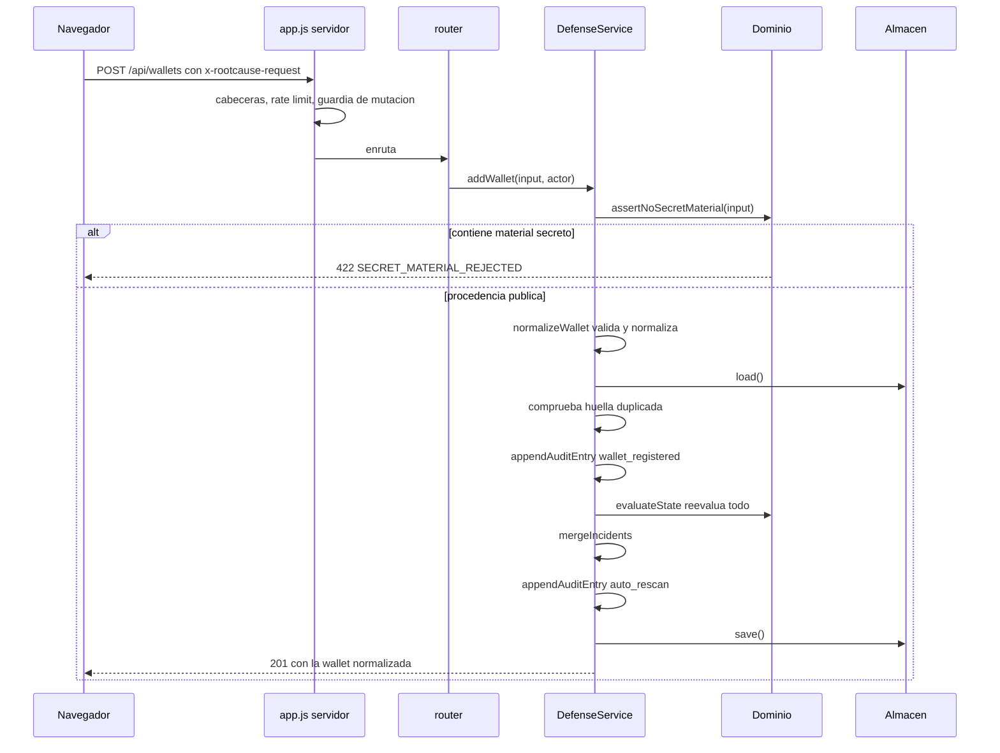
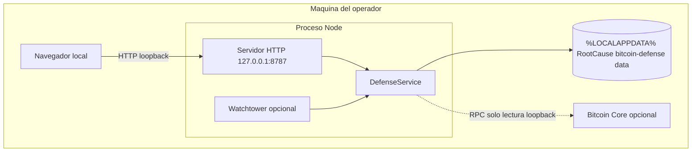

# 03 · Arquitectura

Cómo está organizado el sistema, qué responsabilidad tiene cada capa y por qué
las dependencias apuntan en la dirección en que apuntan.

> Complementa a [`../ARCHITECTURE.md`](../ARCHITECTURE.md), que describe la
> arquitectura desde el producto. Este documento la describe **desde el código**,
> archivo a archivo y con el sentido de cada dependencia verificado por lectura
> de los `import`.

---

## 1 · Estilo arquitectónico

Arquitectura en capas con **dependencias hacia dentro**, próxima a una
arquitectura hexagonal simplificada. No se declara como tal en ningún documento
del repositorio: *es una inferencia del análisis*, confirmada al comprobar que
ningún archivo de `src/domain/` importa nada de `src/infrastructure/` ni de
`src/api/`.

| Capa | Directorio | Depende de | Nadie de esta capa importa |
| --- | --- | --- | --- |
| Entrada | `src/server.js`, `src/app.js`, `src/api/` | Todas | — |
| Casos de uso | `src/services/` | Dominio e infraestructura | Nada de `src/api/` |
| Dominio | `src/domain/` | Solo `node:crypto` y entre sí | Nada de servicios, infraestructura ni API |
| Infraestructura | `src/infrastructure/` | `node:*` y `domain/secret-guard.js` | Nada de servicios ni API |
| Presentación | `src/web/static/` | Solo la API por HTTP | Nada del servidor |

La única dependencia que cruza de infraestructura a dominio es
`audit-log.js → secret-guard.js`, y es deliberada: **redactar antes de escribir**
es una garantía que no puede quedar del lado de quien llama.

---

## 2 · Mapa mental del sistema

**En palabras:** el sistema gira sobre cinco ejes. Tres miran al usuario —de
dónde vienen sus claves, cómo está montada su custodia y qué se observa en la
cadena—, uno mira a la propia herramienta —cómo está desplegada y si su
inteligencia está fresca— y el quinto son las garantías que definen el producto
por lo que se niega a hacer.

---

## 3 · Diagrama de arquitectura

**En palabras:** el navegador solo habla con la capa de entrada por HTTP. La
capa de entrada aplica sus controles y delega en `DefenseService`, que es el
único punto donde se escribe estado. `DefenseService` orquesta el dominio —que
no sabe nada de HTTP ni de archivos— y la infraestructura —que no sabe nada de
reglas—. Las dos fuentes de configuración se cargan una sola vez, al arrancar,
en `server.js`.

---

## 4 · Responsabilidad de cada capa

| Capa | Sí hace | No hace |
| --- | --- | --- |
| Entrada | Cabeceras de seguridad, límite de tasa, guardia de mutación, parseo, serialización | Reglas de negocio, acceso a disco |
| Casos de uso | Validar, normalizar, secuenciar escrituras, reevaluar, auditar | Decidir si algo es un hallazgo |
| Dominio | Decidir qué es un hallazgo y con qué evidencia | Leer archivos, hablar por red, conocer HTTP |
| Infraestructura | Cifrar, encadenar hashes, hablar RPC | Interpretar el significado de los datos |
| Presentación | Renderizar y escapar | Contener lógica de negocio |

---

## 5 · Patrones de diseño identificados

| Patrón | Dónde | Para qué |
| --- | --- | --- |
| Inyección de dependencias por constructor | `DefenseService`, `BitcoinRpcClient`, `Watchtower` | Que las pruebas sustituyan el almacén y el `fetch` sin mocking global |
| Strategy / interfaz común | `MemoryStore` y `EncryptedFileStore` | Un solo par `load()`/`save()`; el servicio no sabe cuál usa |
| Composition root | `server.js` → `buildRuntime()` | Un único sitio donde se decide con qué piezas corre el sistema |
| Objeto de configuración inmutable | `loadConfig()` con `Object.freeze` | Que la autoauditoría mire la misma configuración que gobierna el proceso |
| Allowlist | `READ_ONLY_METHODS`, `STATIC_FILES`, los `Set` de validación | Lo que no está declarado, no pasa |
| Identificador determinista | `findingId()` en `rule-engine.js` y `posture.js` | Reconocer el mismo hallazgo entre análisis sucesivos |
| Cola de escritura secuencial | `DefenseService.mutate()` | Evitar que dos peticiones concurrentes se pisen el estado |
| Hash chain | `audit-log.js` | Detectar la edición de una entrada del registro |
| Fuente única generada | `rules-catalog.json` → `docs/reglas/` y `landing/reglas.html` | Que la documentación no pueda divergir del producto |

---

## 6 · Principios de ingeniería aplicados

| Principio | Evidencia en el código |
| --- | --- |
| Seguro por defecto | Loopback, demo, sin RPC remoto, sin watchtower; verificado en `scripts/check-security-claims.js` |
| Fallar cerrado | `advisoryAffectsWallet` devuelve `false` ante versión ilegible; `validateRpcUrl` lanza |
| Declarar la cobertura | Todo script de auditoría imprime una línea `COBERTURA`; una etapa no ejecutada sale ⚪, nunca 🟢 |
| El claim se verifica, no se afirma | `check-local-only.js`, `check-security-claims.js`, `check-docs.js` son puertas de CI |
| Una sola fuente de verdad | El catálogo genera las fichas; `.claude/` genera `plugin/`; `package.json` fija la versión de `/api/health` |
| Documentar el porqué, no el qué | Comentarios de bloque en español que explican decisiones, no líneas |

---

## 7 · Diagrama de componentes y sus contratos

**En palabras:** `DefenseService` expone doce operaciones públicas y tres
privadas. Depende de una interfaz de almacén con solo dos métodos, implementada
por dos clases intercambiables, y opcionalmente de un cliente RPC. El watchtower
es un consumidor del servicio, no al revés: apagarlo no afecta a nada más.

---

## 8 · Flujo principal, en secuencia

**En palabras:** una petición de registro atraviesa cuatro comprobaciones antes
de tocar nada —cabeceras, tasa, origen local y material secreto—, se normaliza,
se comprueba que la huella no exista ya, se anota en auditoría, **se reevalúa
todo el inventario**, se refunden los incidentes, se anota el reanálisis y solo
entonces se guarda. Si algo falla, no se guarda nada.

---

## 9 · Procesos síncronos y asíncronos

| Proceso | Naturaleza | Disparador |
| --- | --- | --- |
| Petición HTTP | Asíncrona, una por conexión | Navegador o cliente API |
| Evaluación de reglas | **Síncrona y en memoria** | Cada mutación y cada `POST /api/scan` |
| Escritura de estado | Asíncrona, **serializada** por `writeQueue` | Cualquier mutación |
| Watchtower | Asíncrono, `setInterval` con `unref()` | Solo si `WATCHTOWER_ENABLED=true` |
| Consulta RPC | Asíncrona, con `AbortSignal.timeout` | `refreshNode` o tick del watchtower |
| Apertura del navegador | Proceso hijo desacoplado | Solo si `ROOTCAUSE_OPEN_BROWSER=1` y bind loopback |

No hay colas, ni workers, ni trabajos programados dentro del proceso. El único
temporizador es el del watchtower, y no impide que el proceso termine.

---

## 10 · Manejo de estado

El estado completo es **un solo objeto JSON** con `schemaVersion: 1`. No hay
estado parcial ni caché intermedia: cada operación hace `load()`, modifica y
`save()`.

| Campo | Tipo | Contenido |
| --- | --- | --- |
| `schemaVersion` | número | `1` |
| `createdAt`, `updatedAt` | ISO-8601 | Marcas de tiempo |
| `wallets` | array | Inventario normalizado |
| `incidents` | array | Hallazgos con historial y estado |
| `approvals` | array | Hashes de transacción aprobados |
| `observedTransactions` | array | Gastos observados |
| `privacyEvents` | array | Eventos de proveedor |
| `audit` | array | Cadena de entradas encadenadas por hash |
| `node` | objeto o `null` | Último snapshot de Bitcoin Core |

**La postura de despliegue no se guarda.** Se calcula en el momento porque
depende de la configuración del proceso, no de lo que hay en disco
(`DefenseService.posture()`).

---

## 11 · Manejo de errores

Un único patrón en todo el sistema: los errores llevan `statusCode` y `code`, y
la capa HTTP los traduce.

| Situación | Código | Comportamiento |
| --- | --- | --- |
| Validación de entrada | 400 | Mensaje del error, visible al cliente |
| Guardia de mutación local | 403 | `MUTATION_HEADER_REQUIRED` o `CROSS_SITE_REQUEST_REJECTED` |
| Recurso o ruta inexistente | 404 | `NOT_FOUND` |
| Método no permitido en estáticos | 405 | `METHOD_NOT_ALLOWED` |
| Huella de wallet duplicada | 409 | Mensaje explícito |
| Cuerpo demasiado grande | 413 | Se corta durante la lectura del stream |
| Falta `content-type: application/json` | 415 | Antes de leer el cuerpo |
| Material secreto detectado | 422 | `SECRET_MATERIAL_REJECTED` |
| Límite de tasa | 429 | Con `retry-after: 60` |
| Bitcoin Core no configurado | 503 | Mensaje explícito |
| Cualquier otra | 500 | **Mensaje genérico**; el detalle solo va al log del servidor |

Que el 500 no filtre el mensaje interno es deliberado (`src/app.js`): un error no
previsto puede contener rutas del sistema de archivos.

---

## 12 · Autenticación y autorización

**No hay ninguna.** No es un olvido: es el modelo declarado. El sistema asume un
único operador con acceso a la máquina, y por eso:

| Control | Qué sustituye a la autenticación |
| --- | --- |
| Bind en `127.0.0.1` | Solo procesos de la propia máquina alcanzan el puerto |
| Cabecera `x-rootcause-request: 1` | Una página cualquiera de internet no puede mutar por CSRF simple |
| `sec-fetch-site` | Se rechaza toda mutación cross-site que el navegador etiquete |
| CSP `frame-ancestors 'none'` y `x-frame-options: DENY` | Sin clickjacking |
| `BTC-OPSEC-001` | Si alguien sale de loopback, el propio producto lo marca como crítico |

**Consecuencia práctica:** exponer el puerto invalida el modelo entero. Cualquier
usuario de la red vería el inventario y podría modificarlo. Está documentado como
riesgo en [`15-risks-and-technical-debt.md`](15-risks-and-technical-debt.md).

El campo `actor` de la auditoría viene de la cabecera `x-rootcause-actor` y se
valida contra `/^[a-z0-9._@-]{1,80}$/i`. **Es una etiqueta, no una identidad**:
no autentica a nadie.

---

## 13 · Persistencia y caché

| Aspecto | Decisión |
| --- | --- |
| Formato | JSON cifrado dentro de un sobre con `version`, `algorithm`, `iv`, `tag`, `ciphertext` |
| Algoritmo | AES-256-GCM, IV de 12 bytes aleatorio por escritura |
| Clave | 32 bytes exactos, en hex o base64, desde `ROOTCAUSE_DATA_KEY` |
| Escritura | Atómica: temporal con PID + `rename` |
| Permisos | `0700` en el directorio, `0600` en el archivo |
| Caché de servidor | Ninguna. Cada operación relee el estado |
| Caché de cliente | Service worker, red primero, y **`/api/` excluido** |
| Caché HTTP | `no-store` en la API; `no-cache` en `index.html` y `sw.js`; 300 s en el resto |

No hay derivación de clave (KDF): la clave se usa tal cual. Es correcto para una
clave generada aleatoriamente, y arriesgado para una escrita a mano — por eso
existe la regla `BTC-OPSEC-003`.

---

## 14 · Diagrama de despliegue

**En palabras:** todo vive en una sola máquina. El navegador y el proceso se
hablan por loopback, el estado se escribe en el perfil del usuario y el nodo
Bitcoin —si existe— también es local. **No hay ningún componente remoto en el
despliegue soportado.**

En contenedor, el proceso escucha en `0.0.0.0` dentro de su espacio de red y es
el mapeo de puertos del host el que decide la exposición real.

---

## 15 · Procesos en segundo plano

| Proceso | Estado por defecto | Qué hace |
| --- | --- | --- |
| `Watchtower.tick()` | Apagado | `refreshNode()` y después `scan()`, con guardia contra solapamiento |
| Apertura del navegador | Apagada | `spawn` desacoplado, solo si el lanzador lo pide y el bind es loopback |

No hay ningún otro proceso de fondo. Un error dentro del tick se registra en JSON
y no propaga: la vigilancia no puede tumbar el panel.

---

| Siguiente | |
| --- | --- |
| Inventario archivo a archivo | [`04-code-map.md`](04-code-map.md) |
| Cada función, con su firma | [`05-technical-reference.md`](05-technical-reference.md) |
| Volver al índice | [`README.md`](README.md) |
