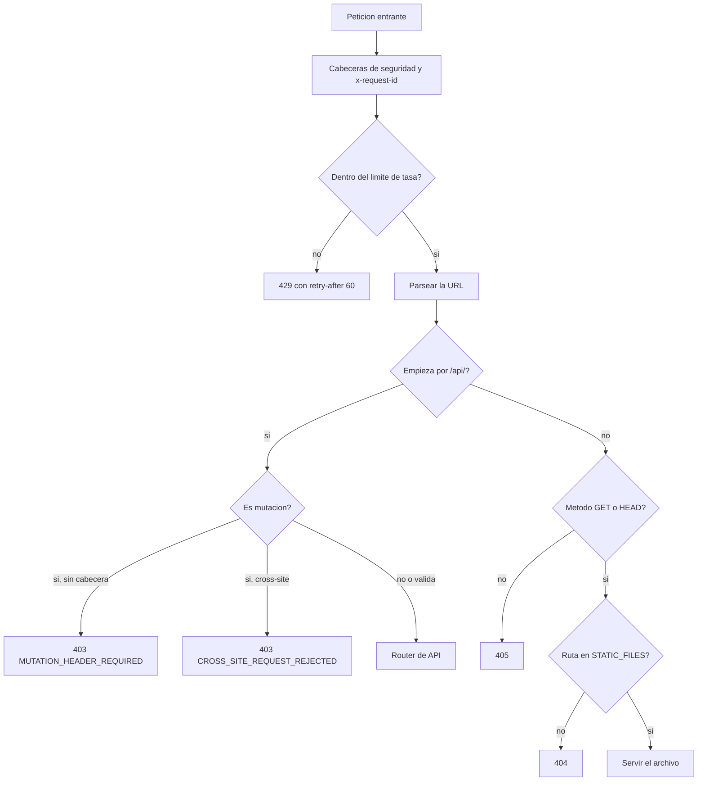
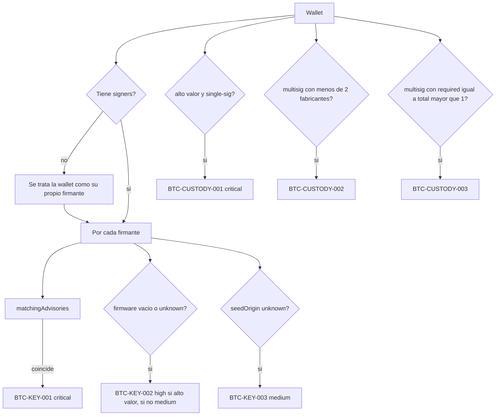
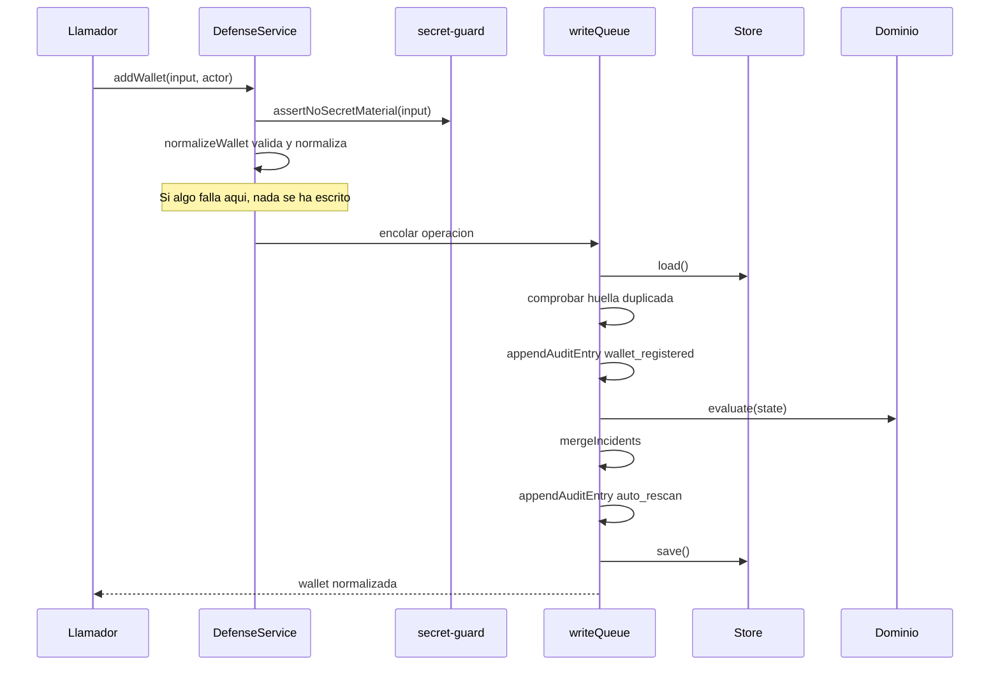
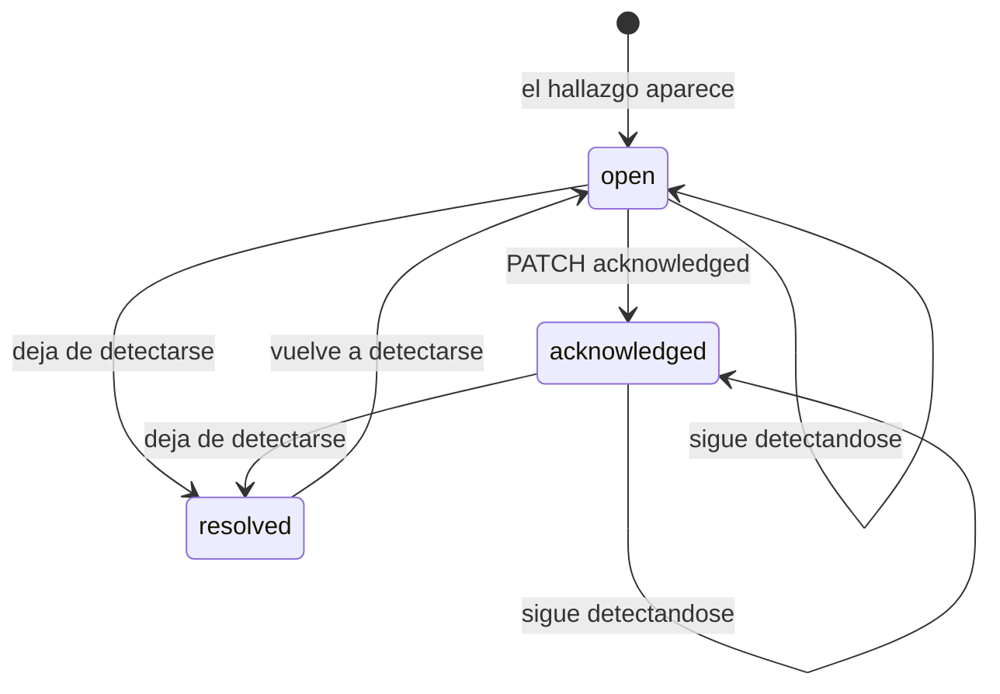

# 06 · Explicación profunda del código

Cómo funciona por dentro cada módulo importante: su flujo, sus decisiones
condicionales, sus casos límite y qué se rompe si se toca.

> Se explica **por bloques lógicos** cuando la explicación línea a línea sería
> ruido, y **línea a línea** cuando el detalle es la sustancia — que aquí ocurre
> en la comparación de firmware, en el guardia de secretos y en la cadena de
> auditoría.

---

## 1 · `src/config.js` — la configuración como contrato

### 1.1 · Objetivo

Convertir un objeto de variables de entorno en un contrato inmutable que
gobierne todo el proceso.

| Entrada | Salida |
| --- | --- |
| `process.env` o cualquier objeto equivalente | Objeto congelado con 12 campos y 2 subobjetos congelados |

### 1.2 · Flujo interno

`parseBoolean` trata **solo `"true"`** como verdadero, comparando en minúsculas.
`"1"`, `"yes"` o `"si"` se interpretan como `false`. Es una decisión estricta que
evita ambigüedad, y una fuente real de confusión: quien escriba `DEMO_MODE=1`
obtendrá persistencia, no demostración.

`parseInteger(value, fallback, minimum, maximum)` hace tres cosas en cuatro
líneas:

1. `Number.parseInt(value ?? "", 10)` — parseo tolerante, acepta `"8787abc"`.
2. `if (!Number.isFinite(parsed)) return fallback` — un valor no numérico cae al
   defecto **sin avisar**.
3. `Math.min(Math.max(parsed, minimum), maximum)` — un valor fuera de rango se
   **recorta**, tampoco avisa.

> **Caso límite documentado:** `RATE_LIMIT_PER_MINUTE=5` no produce 5 peticiones
> por minuto, sino 10, porque ese es el mínimo. Una errata puede pasar
> inadvertida. Ver [`15-risks-and-technical-debt.md`](15-risks-and-technical-debt.md).

### 1.3 · Detección de contenedor

```js
const containerized = parseBoolean(
  env.ROOTCAUSE_CONTAINERIZED,
  fs.existsSync("/.dockerenv") || fs.existsSync("/run/.containerenv")
);
```

Dos rutas porque son dos ecosistemas: `/.dockerenv` lo crea Docker y
`/run/.containerenv` lo crea Podman. El valor explícito gana sobre la detección,
de modo que un entorno atípico pueda corregir el diagnóstico.

**Por qué importa:** dentro de un contenedor, escuchar en `0.0.0.0` es lo normal
y quien decide la exposición real es el mapeo de puertos del host. Sin esta
detección, `BTC-OPSEC-001` gritaría *crítico* en el despliegue soportado, y un
detector que grita en el caso normal enseña a ignorarlo.

### 1.4 · Poscondición

El objeto resultante está congelado, incluidos `bitcoin` y `watchtower`. Nadie
puede mutar la configuración en caliente. Es lo que permite que la autoauditoría
mire exactamente lo mismo que gobierna el proceso.

---

## 2 · `src/app.js` — la frontera HTTP

### 2.1 · Orden de las comprobaciones

El orden no es casual: **lo más barato y lo más protector, primero**.



**En palabras:** las cabeceras de seguridad se ponen *antes* de cualquier
decisión, para que incluso una respuesta de error las lleve. El límite de tasa va
antes de parsear la URL, porque parsear ya es trabajo. La guardia de mutación
va antes del router, para que un intento de CSRF no llegue nunca a tocar el
servicio.

### 2.2 · `applySecurityHeaders(response)` — línea a línea

| Cabecera | Valor | Qué impide |
| --- | --- | --- |
| `content-security-policy` | `default-src 'self'; script-src 'self'; style-src 'self'; img-src 'self' data:; connect-src 'self'; object-src 'none'; base-uri 'self'; form-action 'self'; frame-ancestors 'none'` | Todo origen externo, todo script inline, todo `<object>`, todo `<base>` inyectado, toda incrustación en iframe |
| `cross-origin-opener-policy` | `same-origin` | Que otra ventana mantenga referencia al contexto |
| `cross-origin-resource-policy` | `same-origin` | Que otro sitio incruste los recursos |
| `x-content-type-options` | `nosniff` | Reinterpretación del MIME |
| `x-frame-options` | `DENY` | Clickjacking (redundante con `frame-ancestors`, a propósito) |
| `referrer-policy` | `no-referrer` | Fuga de la URL local hacia terceros |
| `permissions-policy` | `camera=(), microphone=(), geolocation=(), payment=(), usb=()` | Acceso a hardware |

> **`img-src 'self' data:`** es la única concesión: permite imágenes embebidas
> como URI de datos. No permite red.

`scripts/check-local-only.js` lee esta cadena en cada build y falla si pierde
`default-src 'self'`, `script-src 'self'`, `connect-src 'self'`, `object-src
'none'` o `frame-ancestors 'none'`, o si aparece `http:`, `*` o `unsafe-inline`.

### 2.3 · `createRateLimiter(limitPerMinute)`

Ventana fija por dirección de origen, en un `Map`:

```js
const record = clients.get(key);
if (!record || now - record.startedAt >= 60000) {
  clients.set(key, { startedAt: now, count: 1 });
  return true;
}
record.count += 1;
return record.count <= limitPerMinute;
```

| Aspecto | Comportamiento |
| --- | --- |
| Clave | `request.socket.remoteAddress`, o `"unknown"` |
| Ventana | Fija de 60 s desde la primera petición |
| Efecto de borde | Se pueden hacer hasta `2 × límite` peticiones a caballo de dos ventanas |
| Crecimiento del `Map` | **Nunca se purga.** Una entrada por dirección vista |

> 🟡 **Deuda declarada.** En el despliegue soportado —un operador en loopback—
> el `Map` tiene una entrada. Expuesto a una red, crecería sin cota. Es una
> consecuencia más de exponer el puerto, que el propio producto marca como
> crítica con `BTC-OPSEC-001`.

### 2.4 · `readJson(request)` — el límite se aplica durante la lectura

```js
for await (const chunk of request) {
  size += chunk.length;
  if (size > config.bodyLimitBytes) { /* 413 */ }
  chunks.push(chunk);
}
```

El límite se comprueba **mientras** llegan los fragmentos, no después. Es la
diferencia entre rechazar en el primer fragmento que se pasa y bufferizar
primero un cuerpo de 500 MB para después rechazarlo.

`content-type` se exige antes de leer nada. Y un cuerpo vacío se trata como
`{}`, lo que permite `POST /api/scan` con `"{}"` o incluso sin cuerpo.

### 2.5 · Servido de estáticos

```js
const staticDefinition = STATIC_FILES[url.pathname];
if (!staticDefinition) return 404;
const content = await fs.readFile(path.join(staticRoot, fileName));
```

La ruta **nunca** se construye con datos del usuario: se busca en una tabla y de
ahí sale un nombre de archivo fijo. No hay superficie de path traversal, porque
no hay concatenación de entrada arbitraria.

`HEAD` se responde con cabeceras y sin cuerpo, incluido `content-length`
correcto.

### 2.6 · Tratamiento de errores

```js
const status = Number(error.statusCode) || 500;
if (status >= 500) console.error(/* json con el mensaje real */);
return jsonResponse(response, status, {
  error: { code: ..., message: status >= 500 ? "The request could not be completed." : error.message }
});
```

**Regla:** por debajo de 500 el mensaje llega al cliente, porque le sirve para
corregir. A partir de 500 el mensaje real va **solo al log del servidor**, porque
un error no previsto puede contener rutas del sistema de archivos o detalles de
implementación.

---

## 3 · `src/domain/secret-guard.js` — la frontera del producto

### 3.1 · Objetivo

Que sea **imposible** entregarle una semilla a esta aplicación, aunque el usuario
insista.

### 3.2 · Dos coberturas complementarias

| Vector | Defensa | Ejemplo que atrapa |
| --- | --- | --- |
| Campo con nombre revelador | `isForbiddenKey` | `{ "seed": "..." }`, `{ "recovery_phrase": "..." }` |
| Valor con forma de clave en campo inocente | Regex sobre cadenas | `{ "notes": "xprv..." }` |

Ninguna de las dos basta sola: la primera se esquiva renombrando el campo, la
segunda se esquiva codificando el valor. Juntas cubren los casos reales.

### 3.3 · `isForbiddenKey(key)` — línea a línea

```js
const compact = String(key).replace(/[^a-z0-9]/gi, "").toLowerCase();
```

Primero se **normaliza agresivamente**: se eliminan guiones, guiones bajos,
espacios y cualquier símbolo. Así `recovery_phrase`, `recovery-phrase`,
`RecoveryPhrase` y `recovery phrase` se convierten todos en `recoveryphrase`. Es
lo que impide esquivar la lista cambiando el estilo de nomenclatura.

```js
if (PUBLIC_PROVENANCE_FIELDS.has(compact)) return false;
```

**La excepción va antes que la prohibición.** `seedOrigin`, `seedCreatedAt` y
`firmwareAtSeedCreation` contienen la subcadena `seed` y son exactamente los
metadatos públicos que el producto necesita. Sin esta línea, el guardia
bloquearía el uso legítimo del sistema.

```js
return ["seed", "mnemonic", "privatekey", "xprv", "tprv", "passphrase",
        "recoveryphrase", "recoverywords", "walletbackup", "wif"]
  .some((token) => compact.includes(token));
```

Coincidencia por **subcadena**, no por igualdad. `userSeedBackup` se bloquea.

### 3.4 · Recorrido recursivo

`assertNoSecretMaterial` recorre en profundidad:

| Tipo | Acción |
| --- | --- |
| `null` / `undefined` | Retorna. No hay nada que inspeccionar |
| Cadena | Aplica las dos regex; lanza si coincide |
| Array | Recursión por cada elemento, acumulando el índice en `path` |
| Objeto | Para cada clave: si el nombre está prohibido, lanza citando la ruta; si no, recursión sobre el valor |
| Número, booleano | No hace nada — no pueden contener una clave |

**Caso límite:** el guardia no protege contra un valor codificado en base64 que
al decodificarlo fuera una semilla. Es una limitación aceptada: el objetivo es
impedir el error y el descuido, no derrotar a un usuario decidido a
autolesionarse.

### 3.5 · `redactForAudit(value)`

Mismo recorrido, distinto resultado: en vez de lanzar, sustituye.

| Situación | Resultado |
| --- | --- |
| Cadena con forma de clave privada | `"[REDACTED]"` |
| Cadena de más de 512 caracteres | Truncada con `…` al final |
| Campo con nombre prohibido | `"[REDACTED]"`, sin mirar el valor |
| Cualquier otra cosa | Se copia |

Se aplica en `appendAuditEntry` **antes** de calcular el hash, así que lo
redactado nunca llegó a estar en el archivo.

---

## 4 · `src/domain/firmware.js` — la comparación que decide

### 4.1 · Por qué no se usa semver

Los fabricantes de hardware wallets no siguen semver. Los avisos reales de este
repositorio contienen `6.6.0X`, `1.5.0Q` y `6.6.0QX`: la letra final identifica
el modelo y el canal, no una preversión.

### 4.2 · `parseFirmwareVersion(value)`

```js
const match = input.match(/^v?(\d+)(?:\.(\d+))?(?:\.(\d+))?([a-z0-9-]*)$/i);
if (!match) return null;
```

| Elemento | Efecto |
| --- | --- |
| `v?` | Acepta `v4.1.9` y `4.1.9` |
| Grupos 2 y 3 opcionales | `5` se interpreta como `5.0.0` |
| `([a-z0-9-]*)` | Captura el sufijo del fabricante, y se guarda en minúsculas |
| `return null` | **No lanza.** Quien llama decide qué hacer con lo ilegible |

### 4.3 · `compareFirmwareVersions(left, right)`

```js
for (let index = 0; index < 3; index += 1) {
  if (a.numbers[index] < b.numbers[index]) return -1;
  if (a.numbers[index] > b.numbers[index]) return 1;
}
return a.suffix.localeCompare(b.suffix);
```

Comparación numérica por componentes, no lexicográfica. Por eso `4.10.0` es
**mayor** que `4.9.0`, que es justo donde falla una comparación de cadenas.

**Lanza** si alguna versión no parsea. Esa excepción se atrapa un nivel más
arriba.

### 4.4 · `isInRange(version, range)` — el `try/catch` que importa

```js
try {
  if (range.minInclusive && compareFirmwareVersions(version, range.minInclusive) < 0) return false;
  // ... maxInclusive, minExclusive, maxExclusive
  return true;
} catch {
  return false;
}
```

| Decisión | Consecuencia |
| --- | --- |
| Cada límite es **opcional** | Un aviso puede declarar solo `maxExclusive`, como el de COLDCARD para Mk4/Mk5 |
| Sin ningún límite → `true` | Un rango vacío alcanza a **todas** las versiones del modelo |
| `catch { return false }` | Una versión ilegible **no coincide** |

> **Este `catch` es el punto de decisión más consecuente del módulo.** Devolver
> `false` significa: ante la duda, **no** declaramos comprometidos unos fondos.
> El coste es un falso negativo posible; el beneficio es no provocar una
> migración de fondos innecesaria por una errata en un número de versión. La
> ausencia de procedencia se cubre por otra vía, con `BTC-KEY-002`.

### 4.5 · `advisoryAffectsWallet(advisory, wallet)`

Cuatro condiciones, todas obligatorias:

```js
if (canonical(advisory.vendor) !== canonical(wallet.vendor)) return false;
if (!wallet.firmwareAtSeedCreation) return false;
return (advisory.affected || []).some((range) =>
  modelMatches && trackMatches && isInRange(wallet.firmwareAtSeedCreation, range));
```

| Condición | Nota |
| --- | --- |
| Fabricante | Comparación normalizada: `COLDCARD` = `coldcard` |
| Firmware declarado | Sin él no hay nada que comparar |
| Modelo | Debe estar en la lista `models` del rango |
| Canal | Si el rango no declara `track`, coincide con cualquiera; si lo declara, el firmante sin `firmwareTrack` se trata como `standard` |

El aviso de Trezor tiene `affected: []`, así que **nunca genera `BTC-KEY-001`**.
Es correcto: fue una filtración de datos de clientes, no un defecto de claves.
Su efecto llega por `BTC-PRIVACY-002`.

---

## 5 · `src/domain/rule-engine.js` — el motor

### 5.1 · La forma de todo hallazgo

```js
function makeFinding(input) {
  return {
    id: findingId(input.code, input.entityId, input.discriminator),
    detectedAt: input.detectedAt || new Date().toISOString(),
    status: "open",
    ...input
  };
}
```

El *spread* va **al final**, así que quien llama puede sobrescribir `detectedAt`
y `status`. `id` no se puede sobrescribir porque no está en `input`.

`findingId` es `sha256(code|entityId|discriminator)` truncado a 20 caracteres
hexadecimales. **Determinista y sin sal**: el mismo problema produce siempre el
mismo identificador, que es lo que permite reconocerlo entre análisis.

> El `discriminator` existe para distinguir dos instancias del mismo código sobre
> la misma entidad. En `BTC-KEY-001` es `advisoryId:signerId`, así que dos
> firmantes afectados de la misma wallet generan dos hallazgos, no uno.

### 5.2 · `evaluateWallet(wallet, context)` — flujo



**El fallback de la primera decisión merece explicación.** Si una wallet no trae
`signers`, se evalúa la propia wallet como si fuera un firmante:

```js
const signers = Array.isArray(wallet.signers) && wallet.signers.length ? wallet.signers : [wallet];
```

Es compatibilidad con estados antiguos o construidos a mano. En la práctica
`normalizeWallet` exige entre 1 y 5 firmantes, así que por la API nunca ocurre.

### 5.3 · `BTC-CUSTODY-003` — por qué N-de-N es un hallazgo

```js
if (wallet.walletType === "multisig" && total > 1 && required === total) { /* ... */ }
```

Un quorum 3-de-3 parece más seguro que un 2-de-3, y por eso la gente lo elige.
No lo es: sigue haciendo falta comprometer **todas** las claves para robar, pero
basta perder **una** para que los fondos queden irrecuperables para siempre.
Comentado tal cual en el código.

La guarda `total > 1` evita que una single-sig registrada como multisig 1-de-1
dispare la regla.

### 5.4 · `evaluateCorrelations(state, context)` — donde aparecen los ataques

Las reglas anteriores miran una entidad cada una. Estas cruzan varias.

**Base común:** los gastos sin aprobación.

```js
const unapproved = (state.observedTransactions || []).filter((event) =>
  event.spendsWatchedWallet &&
  !(event.approvalHash && approvals.some((entry) => entry.hash === event.approvalHash)));
```

**`BTC-TX-002` — barrido.** Un gasto que se lleva ≥ 90 % del saldo:

```js
if (!wallet || balance <= 0 || value <= 0) continue;
if (value < balance * 0.9) continue;
```

| Guarda | Por qué |
| --- | --- |
| `!wallet` | El evento cita una wallet que no está en el inventario |
| `balance <= 0` | Sin saldo declarado no hay porcentaje que calcular |
| `value <= 0` | `valueSats` es **opcional**: sin importe no se puede distinguir un pago de un vaciado |
| `< 0.9` | Umbral: un pago parcial no es un barrido |

Cubierto por dos pruebas simétricas en `test/attack-patterns.test.js`: una que
detecta el barrido y otra que confirma que un pago del 20 % **no** lo dispara.

**`BTC-TX-003` — ráfaga.** Dos o más gastos sin aprobar de la misma wallet en
menos de una hora:

```js
if (times.length < 2 || times.at(-1) - times[0] > windowMs) continue;
```

Se ordenan las marcas de tiempo y se compara **primera con última**. Con dos
eventos es exacto; con más, mide la ventana completa, no los huecos internos.
Consecuencia: cinco gastos repartidos en 59 minutos sí disparan; dos separados
por dos horas, no.

**`BTC-PRIVACY-002` — el proveedor filtrado fabrica tus firmantes.**

```js
const vendorsInInventory = new Set(
  wallets.flatMap((wallet) => (wallet.signers || []).map((signer) => String(signer.vendor || "").toLowerCase())));
```

Es la regla que convierte una noticia genérica en un riesgo personal: si el
fabricante filtrado es el de tus dispositivos, el phishing dirigido deja de ser
genérico porque quien escribe puede saber qué aparato tienes.

### 5.5 · `evaluateIntel(advisories, context)` — la inteligencia tiene fecha

Tres salidas mutuamente excluyentes, en orden:

| Orden | Condición | Regla |
| ---: | --- | --- |
| 1 | Array vacío o no-array | `BTC-INTEL-002`, high |
| 2 | Ninguna entrada con `verifiedAt` ni `publishedAt` parseable | `BTC-INTEL-003`, medium |
| 3 | El más reciente supera `advisoryMaxAgeDays` | `BTC-INTEL-001`, medium; high si supera el triple |

El `discriminator` de `BTC-INTEL-001` es `String(Math.floor(ageDays / 30))`. Es
un detalle con consecuencia real: **el identificador cambia cada 30 días**, así
que el hallazgo del mes pasado se marca resuelto y aparece uno nuevo. Es
deliberado — vuelve a llamar la atención en vez de quedarse como un aviso viejo
que ya nadie mira.

> **La idea de fondo:** un panel en verde sobre una matriz de avisos sin revisar
> desde hace meses es una tranquilidad falsa, y eso es peor que no tener panel.
> Por eso la antigüedad de la inteligencia es un hallazgo del propio producto.

### 5.6 · `evaluateState(state, context)` — orquestación

```js
const now = context?.now || new Date().toISOString();
const enriched = { ...context, now };
```

**Una sola marca de tiempo para toda la evaluación.** Sin esto, hallazgos de la
misma pasada tendrían `detectedAt` distintos por milisegundos, y las pruebas que
comparan resultados serían no deterministas.

Después concatena las siete familias en un array plano.

> **Precondición, y quién la garantiza:** `state.wallets`,
> `state.observedTransactions` y `state.privacyEvents` deben ser arrays; el motor
> los recorre sin comprobarlos y, si falta alguno, lanza `TypeError`.
> `DefenseService.initialize()` repara **las seis colecciones** antes de la
> primera evaluación, así que un estado incompleto arranca vacío en vez de no
> arrancar. Fue el hallazgo R-03 de
> [`15-risks-and-technical-debt.md`](15-risks-and-technical-debt.md), ya
> corregido y cubierto por `test/incident-lifecycle.test.js`.

---

## 6 · `src/domain/posture.js` — la herramienta se audita a sí misma

### 6.1 · La idea

Es la diferencia entre «tus claves tienen un problema» y «la herramienta con la
que miras tus claves tiene un problema». Lo segundo no suele mirarlo nadie.

### 6.2 · `estimateKeyStrengthBits(key)` — línea a línea

```js
let alphabet = 0;
if (/[a-z]/.test(value)) alphabet += 26;
if (/[A-Z]/.test(value)) alphabet += 26;
if (/[0-9]/.test(value)) alphabet += 10;
if (/[^A-Za-z0-9]/.test(value)) alphabet += 30;
```

Se estima el alfabeto **por las clases que la clave realmente usa**, no por el
alfabeto teórico.

```js
const unique = new Set(value).size;
const effectiveLength = Math.min(value.length, unique * 4);
return Math.round(effectiveLength * Math.log2(Math.max(alphabet, 2)));
```

La línea del medio es la que hace útil la función: una clave de 200 caracteres
`aaaa…` tiene 1 carácter único, así que su longitud efectiva es 4, no 200.

| Entrada | Bits estimados | Veredicto |
| --- | ---: | --- |
| Clave de 32 bytes en base64 del generador | > 200 | 🟢 Sin hallazgo |
| `"clave123"` | ~41 | 🔴 `BTC-OPSEC-003` en severidad high |
| Cadena larga y repetitiva | ~19 | 🔴 high |

> **No mide calidad criptográfica.** Detecta el caso real: alguien escribiendo
> una clave a mano en `config.cmd`. Ambas pruebas están en `test/posture.test.js`.

### 6.3 · `BTC-OPSEC-001` — la severidad que depende del contexto

```js
severity: inContainer ? "medium" : "critical",
```

El mismo hecho —escuchar fuera de loopback— tiene dos lecturas. Fuera de un
contenedor significa que el panel está en la red y no tiene autenticación. Dentro
de un contenedor es el bind normal, y la exposición la decide el mapeo de
puertos.

Ambos casos generan hallazgo, pero con distinto texto, distinta evidencia y
distinta remediación. **Bajar el ruido en el caso normal es lo que mantiene
creíble la alarma en el caso grave.**

### 6.4 · `BTC-OPSEC-008` — la cadena rota

```js
const audit = context.auditVerification;
if (audit && audit.valid === false) { /* critical */ }
```

La comparación estricta con `false` es intencionada: si `auditVerification` no se
pasa —como ocurre en la etapa 11 de la auditoría, que solo mira el cifrado— la
regla **no dispara**. Ausencia de dato no es lo mismo que dato negativo.

---

## 7 · `src/services/defense-service.js` — el orquestador

### 7.1 · La secuencia de toda mutación



**Detalle importante:** la validación ocurre **fuera** de la cola. Una petición
inválida se rechaza sin ocupar el turno de escritura ni cargar el estado.

### 7.2 · `mutate(mutator)` — la cola de escritura

```js
async mutate(mutator) {
  const operation = this.writeQueue.then(async () => {
    const state = await this.store.load();
    const result = await mutator(state);
    state.updatedAt = new Date().toISOString();
    await this.store.save(state);
    return result;
  });
  this.writeQueue = operation.catch(() => {});
  return operation;
}
```

| Línea | Por qué |
| --- | --- |
| `this.writeQueue.then(...)` | La nueva operación empieza cuando termina la anterior |
| `this.writeQueue = operation.catch(() => {})` | **Si una operación falla, la cola continúa.** Sin el `catch`, un rechazo dejaría la cadena rota y toda escritura posterior fallaría |
| `return operation` | Al llamador se le devuelve la promesa **sin** el `catch`, para que sí vea el error |

> **Por qué hace falta en un runtime monohilo:** Node ejecuta un hilo, pero
> `load()` y `save()` son asíncronos. Sin la cola, dos peticiones concurrentes
> harían `load()` sobre el mismo estado, y la segunda escritura pisaría la
> primera.

### 7.3 · `normalizeWallet(input)` — validación cruzada

```js
if (required > total || total !== signers.length) { /* 400 */ }
```

Tres invariantes en una condición: el quorum requerido no puede superar el total,
y el total tiene que coincidir con el número de firmantes. Sin esta línea se
podría registrar un «2-de-3» con un solo firmante, y `BTC-CUSTODY-002` y `003`
juzgarían sobre datos incoherentes.

```js
const vendors = new Set(signers.map((signer) => signer.vendor.toLowerCase()));
// ...
independentVendors: vendors.size
```

`independentVendors` **se calcula**, no se acepta del cliente. Es lo que hace
que `BTC-CUSTODY-002` no se pueda silenciar declarando un número falso.

**Valores por defecto que cambian qué se detecta:**

| Campo | Defecto | Consecuencia |
| --- | --- | --- |
| `firmwareAtSeedCreation` | `"unknown"` | Dispara `BTC-KEY-002` |
| `seedOrigin` | `"unknown"` | Dispara `BTC-KEY-003` |
| `firmwareTrack` | `"standard"` | Afecta a la coincidencia con avisos que declaran canal |
| `network` | `"mainnet"` | — |
| `status` | `"active"` | — |

**Omitir la procedencia no oculta el problema: lo convierte en un hallazgo.** Es
la decisión de diseño más importante del módulo.

### 7.4 · `mergeIncidents(existing, findings, now)` — el ciclo de vida

> Es la única función privada por convención que se **exporta**: `test/incident-lifecycle.test.js`
> la ejercita con 12 casos. Gobierna el historial de todo incidente y una
> regresión aquí sería silenciosa, así que se prueba directamente y no solo a
> través de la API.

```js
for (const finding of findings) {
  const previous = byId.get(finding.id);
  byId.set(finding.id, {
    ...finding,
    createdAt: previous?.createdAt || now,
    lastSeenAt: now,
    status: previous?.status === "acknowledged" ? "acknowledged" : "open",
    acknowledgedAt: previous?.acknowledgedAt,
    acknowledgedBy: previous?.acknowledgedBy
  });
}
for (const [id, incident] of byId) {
  if (!activeIds.has(id) && ["open", "acknowledged"].includes(incident.status)) {
    byId.set(id, { ...incident, status: "resolved", resolvedAt: now });
  }
}
```



**En palabras:** un incidente nace `open` cuando su regla se cumple por primera
vez. Alguien puede marcarlo `acknowledged`, y ese estado sobrevive a los
reanálisis mientras la condición siga dándose. En cuanto deja de detectarse pasa
a `resolved` por sí solo, desde cualquiera de los dos estados anteriores. Y si el
problema reaparece, vuelve a `open`: el mismo identificador determinista lo
reconoce como el mismo incidente de siempre, no como uno nuevo.

| Regla | Efecto práctico |
| --- | --- |
| `createdAt` se conserva | Se sabe desde cuándo existe el problema, no desde cuándo se miró |
| `acknowledged` sobrevive al reanálisis | Reconocer no obliga a reconocer otra vez cada vez que se analiza |
| Lo ausente pasa a `resolved` **solo** desde `open` o `acknowledged` | Un incidente ya resuelto no se re-resuelve, y conserva su `resolvedAt` original |
| Reaparecer vuelve a `open` | La primera rama del bucle lo sobrescribe |

> **Reconocer un incidente no lo apaga.** Sigue contando en la puntuación de
> riesgo, porque `summary()` considera activos tanto `open` como `acknowledged`.
> Reconocer documenta que alguien lo vio; solo desaparece cuando el problema
> deja de existir.

### 7.5 · `summary()` frente a `posture()`

| Aspecto | `summary()` | `posture()` |
| --- | --- | --- |
| Fuente | Incidentes **guardados** | Configuración **viva** |
| Riesgo sobre | Incidentes activos | Solo los hallazgos de postura |
| Se persiste | Sí, los incidentes | **No** |
| Incidentes devueltos | Los 20 primeros | Todos los de postura |

La postura no se guarda porque depende de con qué variables arrancó el proceso.
Guardarla significaría mostrar la configuración del arranque anterior.

### 7.6 · `rescanAfterChange(state, actor, reason)`

Reevalúa y anota un `auto_rescan` con `findings`, `incidentsBefore` e
`incidentsAfter`. Se llama **solo desde `addWallet`**.

> 🟡 **Asimetría real.** `observeTransaction` y `observePrivacyEvent` también
> reevalúan y refunden incidentes, pero **no** escriben la entrada `auto_rescan`.
> El efecto sobre las reglas es idéntico; lo que difiere es la traza de
> auditoría. Anotado en [`15-risks-and-technical-debt.md`](15-risks-and-technical-debt.md).

---

## 8 · `src/infrastructure/audit-log.js` — la cadena

### 8.1 · `canonicalize(value)` — por qué existe

```js
if (value && typeof value === "object") {
  return Object.fromEntries(Object.keys(value).sort().map((key) => [key, canonicalize(value[key])]));
}
```

`JSON.stringify` respeta el orden de inserción de las claves. Dos objetos con el
mismo contenido y distinto orden producirían hashes distintos, y la verificación
daría falsos positivos de manipulación. Ordenar las claves recursivamente
elimina esa dependencia.

### 8.2 · `appendAuditEntry(audit, input)`

```js
const previousHash = audit.at(-1)?.hash || "GENESIS";
const entryWithoutHash = { id, occurredAt, actor, action, entityType, entityId,
                           metadata: redactForAudit(input.metadata || {}), previousHash };
return [...audit, { ...entryWithoutHash, hash: digest(entryWithoutHash) }];
```

| Detalle | Por qué |
| --- | --- |
| `"GENESIS"` | Ancla de la primera entrada, para que la verificación empiece en un valor conocido |
| `redactForAudit` **aquí** | La redacción ocurre antes del hash: lo redactado nunca estuvo en el archivo |
| `[...audit, ...]` | Devuelve un array nuevo. **No muta** el original |
| El hash se calcula sobre la entrada **sin** su propio hash | Un hash no puede incluirse a sí mismo |

### 8.3 · `verifyAuditChain(audit)`

Dos comprobaciones por entrada, y el orden importa:

```js
if (entryWithoutHash.previousHash !== previousHash) return { valid: false, reason: "previous_hash_mismatch" };
if (digest(entryWithoutHash) !== hash) return { valid: false, reason: "entry_hash_mismatch" };
```

| Comprobación | Qué detecta |
| --- | --- |
| `previous_hash_mismatch` | Una entrada **eliminada** o **reordenada** |
| `entry_hash_mismatch` | Una entrada **editada** |

Una cadena vacía devuelve `{ valid: true, entries: 0, head: "GENESIS" }`.

> **Qué no impide:** que alguien con acceso al archivo lo reescriba entero y
> recalcule todos los hashes. Es un registro **a prueba de manipulación
> detectable**, no a prueba de manipulación. Lo que hace imposible es editar un
> solo evento sin que se note, que es el caso realista.

---

## 9 · `src/infrastructure/encrypted-store.js`

### 9.1 · `decodeDataKey(value)` — el orden de la detección

```js
const key = /^[0-9a-f]{64}$/i.test(input) ? Buffer.from(input, "hex") : Buffer.from(input, "base64");
if (key.length !== 32) throw new Error("ROOTCAUSE_DATA_KEY must decode to exactly 32 bytes.");
```

Se prueba hex **primero** porque una cadena de 64 caracteres hexadecimales
también es base64 válida, y decodificarla como base64 daría 48 bytes. La
comprobación final de longitud es la que atrapa cualquier otro error.

### 9.2 · El sobre cifrado

```json
{
  "version": 1,
  "algorithm": "aes-256-gcm",
  "iv": "...",
  "tag": "...",
  "ciphertext": "..."
}
```

`decryptJson` verifica `version` y `algorithm` antes de intentar nada. El campo
`version` es lo que permitirá migrar el formato en el futuro sin adivinar.

**IV aleatorio de 12 bytes en cada escritura.** Reutilizar un IV en GCM es un
fallo criptográfico grave, y aquí no puede ocurrir porque se genera con
`crypto.randomBytes` en cada `encryptJson`.

**GCM y no CBC** porque autentica: si alguien altera un byte del archivo, el
descifrado lanza en vez de devolver basura que la aplicación interpretaría como
estado.

### 9.3 · `save(nextState)` — escritura atómica

```js
await fs.mkdir(path.dirname(this.filePath), { recursive: true, mode: 0o700 });
const temporaryPath = this.filePath + "." + process.pid + ".tmp";
await fs.writeFile(temporaryPath, JSON.stringify(envelope, null, 2), { encoding: "utf8", mode: 0o600 });
await fs.rename(temporaryPath, this.filePath);
```

| Elemento | Por qué |
| --- | --- |
| `process.pid` en el nombre temporal | Dos procesos con el mismo `DATA_DIR` no se pisan el temporal |
| `rename` | En el mismo sistema de archivos es atómico: el estado nunca queda a medias |
| `0700` / `0600` | En un sistema multiusuario, el estado no lo lee nadie más |

> **En Windows los modos POSIX se ignoran.** La protección real la da la ACL del
> perfil del usuario, y por eso el lanzador guarda los datos en
> `%LOCALAPPDATA%`.

### 9.4 · `load()` — el `ENOENT` que no es un error

```js
catch (error) {
  if (error.code === "ENOENT") return structuredClone(this.initialState);
  throw error;
}
```

Solo se tolera «el archivo no existe», que es el primer arranque. **Un archivo
corrupto, ilegible o cifrado con otra clave propaga el error** y el arranque
falla. Es lo correcto: arrancar con estado vacío tras un fallo de descifrado
sería silenciar la pérdida de todo el inventario.

### 9.5 · `MemoryStore` y `structuredClone`

Los tres métodos clonan en profundidad. Así el estado devuelto por `load()` no es
el mismo objeto que guarda el almacén, y una mutación accidental del llamador no
altera lo persistido sin pasar por `save()`. **Es lo que hace que `MemoryStore`
se comporte igual que `EncryptedFileStore` en las pruebas.**

---

## 10 · `src/infrastructure/bitcoin-rpc.js`

### 10.1 · `call(method, params)` — el orden de las defensas

```js
if (!READ_ONLY_METHODS.has(method)) throw new Error("RPC method is not in the read-only allowlist: " + method);
```

**Primera línea del método.** Antes de leer credenciales, antes de construir
cabeceras, antes de tocar la red.

```js
const response = await this.fetch(this.url, {
  method: "POST",
  redirect: "error",
  headers,
  signal: AbortSignal.timeout(this.config.timeoutMs),
  body: JSON.stringify({ jsonrpc: "2.0", id: this.nextId++, method, params })
});
```

| Opción | Qué protege |
| --- | --- |
| `redirect: "error"` | Un nodo comprometido no puede redirigir la petición —con sus credenciales Basic— a otro destino |
| `AbortSignal.timeout` | Un nodo que no responde no cuelga el proceso |
| `this.nextId++` | Identificadores JSON-RPC crecientes |

```js
const contentLength = Number(response.headers.get("content-length") || 0);
if (contentLength > 2097152) throw new Error("Bitcoin RPC response is too large.");
const raw = await response.text();
if (raw.length > 2097152) throw new Error("Bitcoin RPC response is too large.");
```

**Doble comprobación de tamaño, y hace falta:** la cabecera puede faltar o mentir,
así que se vuelve a comprobar sobre el cuerpo real. Sin ninguna de las dos, una
respuesta enorme agotaría la memoria.

El orden también importa: se lee el cuerpo **antes** de comprobar `response.ok`,
porque el mensaje de error del nodo puede venir en el cuerpo.

### 10.2 · `credentials(config)`

```js
if (config.cookieFile) {
  const cookie = (await fs.readFile(config.cookieFile, "utf8")).trim();
  if (!cookie.includes(":")) throw new Error("Invalid Bitcoin Core cookie file.");
  return cookie;
}
if (config.user || config.password) return config.user + ":" + config.password;
return "";
```

La cookie tiene prioridad, y **se lee en cada llamada**: Bitcoin Core la rota, y
cachearla daría fallos de autenticación tras un reinicio del nodo. El coste es
una lectura de archivo por llamada, insignificante frente a la petición HTTP.

Sin credenciales se devuelve cadena vacía y no se envía cabecera `authorization`.
Es válido en algunas configuraciones de regtest.

### 10.3 · `snapshot()` — cuatro llamadas, un objeto

Las cuatro llamadas son **secuenciales**, no en paralelo. Con un nodo local el
coste es despreciable, y secuencial hace que el primer fallo corte el resto.

```js
warnings: blockchain.warnings || network.warnings || [],
```

Bitcoin Core movió `warnings` entre respuestas según la versión. Se prueban ambas
y se cae a array vacío.

El `catch` devuelve un objeto con `connected: false` en vez de propagar. Ese
objeto es exactamente lo que `evaluateNode` necesita para emitir `BTC-NODE-001`.

---

## 11 · `src/web/static/app.js` — el panel

### 11.1 · Estructura

Tres piezas: un objeto `state` en memoria, funciones `render*` que producen HTML
por concatenación, y un envoltorio `api()` sobre `fetch`.

### 11.2 · `escapeHtml(value)` — la única defensa contra XSS

```js
return String(value ?? "").replace(/[&<>"']/g, (character) => entities[character]);
```

Los cinco caracteres son los correctos para contenido de elemento y para valor de
atributo entrecomillado. **Todo** dato que viene del servidor pasa por aquí antes
de entrar en el DOM: títulos de incidente, nombres de wallet, mensajes de error,
huellas y nombres de fabricante.

> **Riesgo al modificar:** el render se hace con `innerHTML` y concatenación de
> cadenas. Olvidar un `escapeHtml` en una interpolación nueva abre XSS. La CSP
> `script-src 'self'` limita el daño —un `<script>` inline inyectado no se
> ejecutaría— pero no cubre todos los vectores, como `onerror` en una imagen.

### 11.3 · `safeUrl(value)`

```js
const url = new URL(value);
return ["https:", "http:"].includes(url.protocol) ? url.href : "#";
```

Solo se aplica a las URL de fuentes de los avisos, que es el único sitio donde el
panel construye un `href` con datos. Bloquea `javascript:` y `data:`. Una URL
malformada cae a `"#"`.

### 11.4 · `api(path, options)`

```js
if (mutation) {
  headers["content-type"] = "application/json";
  headers["x-rootcause-request"] = "1";
}
```

La cabecera de mutación se añade en un solo sitio. Cualquier llamada que no pase
por aquí recibirá 403, lo cual es la red de seguridad deseada.

### 11.5 · `submitWallet(form)` — la simplificación deliberada

```js
const signerCount = walletType === "multisig" ? 3 : 1;
// ...
quorum: walletType === "multisig" ? { required: 2, total: 3 } : { required: 1, total: 1 }
```

El formulario del panel **solo permite single-sig y multisig 2-de-3**. La API
acepta de 1 a 5 firmantes y cualquier quorum coherente. Es una limitación de la
interfaz, no del sistema: para otras configuraciones hay que usar la API.

Consecuencia curiosa: **`BTC-CUSTODY-003` (N-de-N) no se puede provocar desde el
panel**, solo por la API. La prueba correspondiente vive en
`test/attack-patterns.test.js`.

### 11.6 · Flujo tras registrar una wallet

```js
await api("/api/wallets", { method: "POST", body: JSON.stringify(payload) });
await api("/api/scan", { method: "POST", body: "{}" });
form.reset();
renderSignerFields(1);
await refresh();
```

El `scan` explícito es **redundante**: `addWallet` ya llama a
`rescanAfterChange`. El efecto en las reglas es idéntico; lo que añade es una
entrada `risk_scan_completed` en la auditoría, además del `auto_rescan`.

---

## 12 · `scripts/audit-bitcoin.js` — las 14 etapas

### 12.1 · Estructura

Un array `STAGES` de 14 objetos, cada uno con `number`, `id`, `title`,
`question` y `run()`. El bucle principal ejecuta cada uno y captura sus errores:

```js
try {
  outcome = await stage.run();
} catch (error) {
  outcome = { status: "fallo", coverage: "la etapa no pudo completarse", details: [error.message],
              actions: ["Revisar por qué falló la etapa: una etapa rota no es una etapa aprobada."] };
}
```

**Una etapa que revienta sale como fallo, no desaparece del informe.**

### 12.2 · Los cuatro estados

| Estado | Icono | Significado | ¿Bloquea? |
| --- | --- | --- | --- |
| `ok` | 🟢 | La comprobación se hizo y salió bien | No |
| `atencion` | 🟡 | Deuda declarada, no rotura | Solo con `--fail-on-attention` |
| `fallo` | 🔴 | Una promesa del producto dejó de cumplirse | Sí |
| `omitida` | ⚪ | **No comprobada.** Nunca es un aprobado | No |

> La distinción entre 🟡 y ⚪ es el corazón del criterio. «Con atención» es un
> hallazgo real que alguien decidió aceptar. «Omitida» es una superficie que
> **nadie miró**, y presentarla como verde sería mentir con formato de informe.

### 12.3 · De dónde sale el inventario

```js
if (!config.demoMode && config.dataKey) { /* EncryptedFileStore */ }
else { /* createDemoState() */ }
```

`stateSource` se imprime en la cabecera del informe. Sin eso, un informe sobre el
inventario de demostración parecería un informe sobre la custodia real.

### 12.4 · Etapas que se apoyan en otros scripts

Las etapas 4 a 8 lanzan otro script como proceso hijo con `spawnSync` y
convierten su código de salida en estado. La 6 tiene una regla especial:

```js
const skipped = /No se pudo descargar/.test(result.stdout + result.stderr);
status: skipped ? "omitida" : result.status === 0 ? "ok" : "fallo",
```

Sin red, la etapa sale **omitida**, no verde. Es la regla de honestidad aplicada
al código.

---

## 13 · Casos límite recogidos, en una tabla

| Caso | Módulo | Comportamiento |
| --- | --- | --- |
| Versión de firmware ilegible | `firmware.js` | No coincide con ningún aviso |
| Rango de aviso sin límites | `firmware.js` | Alcanza a todas las versiones del modelo |
| Wallet sin `signers` | `rule-engine.js` | Se evalúa la wallet como su propio firmante |
| `valueSats` ausente | `rule-engine.js` | `BTC-TX-002` no se puede evaluar; se omite |
| `walletId` inexistente | `rule-engine.js` | `BTC-TX-001` dispara; `BTC-TX-002` no |
| Multisig 1-de-1 | `rule-engine.js` | `BTC-CUSTODY-003` no dispara por la guarda `total > 1` |
| Matriz de avisos vacía | `rule-engine.js` | `BTC-INTEL-002`, high |
| Cadena de auditoría vacía | `audit-log.js` | Válida, `head: "GENESIS"` |
| `auditVerification` ausente | `posture.js` | `BTC-OPSEC-008` no dispara |
| Sin `context.config` | `posture.js` | Devuelve array vacío, no inventa hallazgos |
| Archivo de estado ausente | `encrypted-store.js` | Estado inicial |
| Archivo de estado corrupto | `encrypted-store.js` | **Lanza.** El arranque falla |
| Clave incorrecta | `encrypted-store.js` | Lanza en la verificación del tag GCM |
| Cuerpo HTTP vacío | `app.js` | Se trata como `{}` |
| `sec-fetch-site` ausente | `app.js` | Pasa el control cross-site |
| Nodo caído | `bitcoin-rpc.js` | `{connected: false}`, alimenta `BTC-NODE-001` |
| Puerto 0 | `config.js` | El sistema operativo asigna uno libre |

---

| Siguiente | |
| --- | --- |
| El modelo de datos completo | [`07-database.md`](07-database.md) |
| Cómo circulan los datos | [`08-data-flow.md`](08-data-flow.md) |
| Volver al índice | [`README.md`](README.md) |
