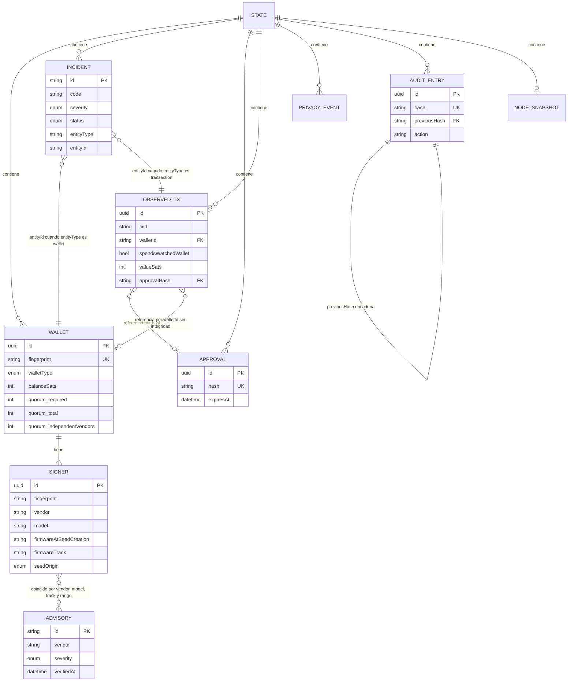

# 07 · Base de datos y persistencia

**Este sistema no usa ningún motor de base de datos.** Lo que sigue documenta el
mecanismo de persistencia que usa en su lugar, con el mismo detalle con el que se
documentaría un esquema relacional.

---

## 1 · Veredicto y evidencia

| Pregunta | Respuesta | Evidencia |
| --- | --- | --- |
| ¿Hay un SGBD? | **No** | Cero dependencias declaradas; `check-local-only.js` lo verifica en cada build |
| ¿Hay SQL? | **No** | Ninguna cadena SQL en todo el árbol |
| ¿Hay ORM o migraciones? | **No** | No existe `migrations/`, `prisma/`, `models/` ni equivalente |
| ¿Hay procedimientos, vistas o triggers? | **No aplica** | — |
| ¿Cómo persiste entonces? | **Un archivo JSON cifrado**, o memoria volátil | `src/infrastructure/encrypted-store.js` |

Que no haya base de datos no es una carencia: es coherente con el producto. Un
SGBD implicaría un proceso más, un puerto más, credenciales que gestionar y un
árbol de dependencias — todo lo que este proyecto evita a propósito. El
razonamiento está en [`../ADR-0001-plataforma-y-lenguaje.md`](../ADR-0001-plataforma-y-lenguaje.md).

---

## 2 · Los dos modos de persistencia

| Modo | Clase | Dónde vive el estado | Sobrevive al cierre |
| --- | --- | --- | --- |
| Demostración (`DEMO_MODE=true`, por defecto) | `MemoryStore` | Memoria del proceso | No |
| Persistente (`DEMO_MODE=false`) | `EncryptedFileStore` | `${DATA_DIR}/state.enc.json` | Sí |

Ambas exponen el mismo contrato de dos métodos:

| Método | Firma | Contrato |
| --- | --- | --- |
| `load()` | `async () => state` | Devuelve una **copia profunda**; nunca el objeto interno |
| `save(nextState)` | `async (state) => void` | Reemplaza el estado completo |

**No hay lectura ni escritura parcial.** Cada operación carga el estado entero,
lo modifica y lo vuelve a escribir entero.

---

## 3 · Configuración de la conexión

| Variable | Papel | Obligatoria |
| --- | --- | --- |
| `DEMO_MODE` | `false` activa la persistencia | No, por defecto `true` |
| `ROOTCAUSE_DATA_KEY` | Clave AES-256, 32 bytes en hex o base64 | **Sí**, si `DEMO_MODE=false` |
| `DATA_DIR` | Directorio del archivo | No, por defecto `./data` |

La ruta efectiva se compone en `src/config.js`:

```js
dataFile: path.join(dataDir, "state.enc.json")
```

En la edición de Windows, el lanzador fija `DATA_DIR` a
`%LOCALAPPDATA%\RootCause\bitcoin-defense\data`, fuera de la carpeta del
programa, para que los datos sobrevivan a una desinstalación.

Sin clave, el arranque falla de forma explícita
(`assertProductionConfig`), en vez de degradar en silencio a memoria.

---

## 4 · El formato en disco

El archivo es un JSON en claro que **contiene** el estado cifrado:

```json
{
  "version": 1,
  "algorithm": "aes-256-gcm",
  "iv": "base64 de 12 bytes",
  "tag": "base64 del tag de autenticacion GCM",
  "ciphertext": "base64 del estado completo cifrado"
}
```

| Campo | Tipo | Para qué |
| --- | --- | --- |
| `version` | entero | Versión del sobre. Permite migrar el formato sin adivinar |
| `algorithm` | cadena | Se verifica antes de descifrar; solo se acepta `aes-256-gcm` |
| `iv` | base64 | Vector de inicialización, **12 bytes aleatorios en cada escritura** |
| `tag` | base64 | Tag de autenticación GCM; un byte alterado hace fallar el descifrado |
| `ciphertext` | base64 | El objeto de estado completo, serializado y cifrado |

**Fuera del sobre no hay metadatos en claro.** Ni número de wallets, ni fechas,
ni saldos. `test/encrypted-store.test.js` lo comprueba explícitamente.

---

## 5 · Diccionario de datos

### 5.1 · Raíz del estado

| Campo | Tipo | Nulo | Defecto | Descripción |
| --- | --- | --- | --- | --- |
| `schemaVersion` | entero | No | `1` | Versión del esquema lógico |
| `createdAt` | ISO-8601 | No | Momento de creación | Cuándo se creó el estado |
| `updatedAt` | ISO-8601 | No | Cada `save()` | Última escritura |
| `wallets` | array | No | `[]` | Inventario |
| `incidents` | array | No | `[]` | Hallazgos con historial |
| `approvals` | array | No | `[]` | Hashes aprobados |
| `observedTransactions` | array | No | `[]` | Gastos observados |
| `privacyEvents` | array | No | `[]` | Eventos de proveedor |
| `audit` | array | No | `[]` | Cadena de auditoría |
| `node` | objeto | **Sí** | `null` | Último snapshot de Bitcoin Core |

### 5.2 · `wallets[]`

| Campo | Tipo | Restricción | Origen |
| --- | --- | --- | --- |
| `id` | UUID v4 | Generado por el servidor | `crypto.randomUUID()` |
| `name` | cadena | 1–120 caracteres | Entrada del usuario |
| `fingerprint` | cadena | **Exactamente 8 hex**, en mayúsculas | Entrada, normalizada |
| `network` | enum | `mainnet` · `signet` · `regtest` · `testnet4` | Entrada, defecto `mainnet` |
| `walletType` | enum | `single-sig` · `multisig` | Entrada, **obligatorio** |
| `balanceSats` | entero | ≥ 0, entero seguro | Entrada, defecto `0` |
| `status` | enum | `active` · `migration-required` · `quarantined` · `retired` | Entrada, defecto `active` |
| `quorum.required` | entero | 1–5, ≤ `total` | Entrada o derivado |
| `quorum.total` | entero | 1–5, **= número de firmantes** | Entrada o derivado |
| `quorum.independentVendors` | entero | **Calculado**, no aceptado del cliente | `new Set(vendors).size` |
| `signers` | array | 1–5 elementos | Entrada |
| `tags` | array de cadena | Máx. 10, cada una ≤ 30 caracteres | Entrada, defecto `[]` |

**Restricción de unicidad:** `fingerprint` es único en `wallets`. Se comprueba en
`addWallet` y devuelve 409 si se repite. **No hay unicidad sobre `signers`**: la
misma huella de firmante puede aparecer en varias wallets, lo cual es correcto
—un dispositivo puede participar en varios quórums—.

### 5.3 · `wallets[].signers[]`

| Campo | Tipo | Restricción | Defecto |
| --- | --- | --- | --- |
| `id` | UUID v4 | Generado por el servidor | — |
| `label` | cadena | ≤ 80 caracteres | `"Firmante N"` |
| `fingerprint` | cadena | **Exactamente 8 hex**, mayúsculas | Obligatorio |
| `vendor` | cadena | ≤ 80 caracteres | Obligatorio |
| `model` | cadena | ≤ 80 caracteres | Obligatorio |
| `firmwareAtSeedCreation` | cadena | ≤ 40 caracteres | `"unknown"` → dispara `BTC-KEY-002` |
| `firmwareTrack` | cadena | ≤ 30 caracteres | `"standard"` |
| `seedOrigin` | enum | `device` · `dice` · `external` · `unknown` | `"unknown"` → dispara `BTC-KEY-003` |
| `createdAt` | ISO-8601 | — | Momento actual |

> **Ningún campo de esta tabla es secreto.** No hay clave pública extendida, ni
> descriptor, ni derivación. Solo huella y procedencia declarada. Un campo cuyo
> nombre sugiera material secreto se rechaza con 422 antes de llegar aquí.

### 5.4 · `incidents[]`

| Campo | Tipo | Descripción |
| --- | --- | --- |
| `id` | 20 hex | **Determinista**: `sha256(code\|entityId\|discriminator)` truncado |
| `code` | cadena | Código de regla, p. ej. `BTC-KEY-001` |
| `severity` | enum | `critical` · `high` · `medium` · `low` · `info` |
| `title` | cadena | Titular del hallazgo |
| `explanation` | cadena | Qué se observó |
| `rootCause` | cadena | **Causa raíz declarada** |
| `evidence` | objeto | Datos públicos que sostienen la afirmación |
| `remediation` | array de cadena | Pasos, en orden de ejecución |
| `entityType` | cadena | `wallet` · `transaction` · `node` · `vendor-event` · `advisory-matrix` · `deployment` |
| `entityId` | cadena | Identificador de la entidad afectada |
| `status` | enum | `open` · `acknowledged` · `resolved` |
| `detectedAt` | ISO-8601 | Cuándo lo produjo el motor |
| `createdAt` | ISO-8601 | **Primera vez** que se vio; se conserva entre análisis |
| `lastSeenAt` | ISO-8601 | Último análisis en que seguía activo |
| `acknowledgedAt` / `acknowledgedBy` | ISO-8601 / cadena | Solo si se reconoció |
| `resolvedAt` / `resolvedBy` | ISO-8601 / cadena | Solo si se resolvió |

### 5.5 · `approvals[]`

| Campo | Tipo | Restricción |
| --- | --- | --- |
| `id` | UUID v4 | Generado |
| `hash` | cadena | **Exactamente 64 hex**, minúsculas |
| `label` | cadena | ≤ 120 caracteres, defecto `"PSBT aprobada"` |
| `createdAt` | ISO-8601 | — |
| `expiresAt` | ISO-8601 o `null` | 🟡 **Se guarda pero no se comprueba** en ninguna regla |
| `actor` | cadena | De `x-rootcause-actor` |

### 5.6 · `observedTransactions[]`

| Campo | Tipo | Restricción |
| --- | --- | --- |
| `id` | UUID v4 | Generado |
| `txid` | cadena | **Exactamente 64 hex**, minúsculas |
| `walletId` | cadena | ≤ 80 caracteres. 🟡 **No se valida contra el inventario** |
| `spendsWatchedWallet` | booleano | Defecto `true`; solo `false` explícito lo desactiva |
| `valueSats` | entero o `null` | Opcional. Sin él, `BTC-TX-002` no puede evaluarse |
| `approvalHash` | 64 hex o `null` | Se cruza con `approvals[].hash` |
| `source` | cadena | ≤ 30 caracteres, defecto `"manual"` |
| `observedAt` | ISO-8601 | **Del servidor**, no del cliente |

### 5.7 · `privacyEvents[]`

| Campo | Tipo | Restricción |
| --- | --- | --- |
| `id` | UUID v4 | Generado |
| `type` | cadena | **Solo** `bulk_customer_data_access`; cualquier otro valor da 400 |
| `vendor` | cadena | ≤ 120 caracteres |
| `recordCount` | entero | ≥ 1 |
| `authorized` | booleano | Solo `true` explícito; cambia la severidad de critical a medium |
| `observedAt` | ISO-8601 | Del servidor |

### 5.8 · `audit[]`

| Campo | Tipo | Descripción |
| --- | --- | --- |
| `id` | UUID v4 | Identificador de la entrada |
| `occurredAt` | ISO-8601 | Momento del evento |
| `actor` | cadena | Etiqueta del actor, defecto `"system"` |
| `action` | cadena | Uno de los 9 valores del catálogo de acciones |
| `entityType` | cadena | Defecto `"system"` |
| `entityId` | cadena | Defecto `"rootcause-bitcoin-defense"` |
| `metadata` | objeto | **Pasado por `redactForAudit`** antes de escribirse |
| `previousHash` | 64 hex | Hash de la entrada anterior, o `"GENESIS"` |
| `hash` | 64 hex | `sha256` de la entrada canónica sin este campo |

### 5.9 · `node`

| Campo | Tipo | Origen RPC |
| --- | --- | --- |
| `connected` | booleano | Si las cuatro llamadas tuvieron éxito |
| `endpoint` | cadena | Protocolo y host, **sin credenciales** |
| `checkedAt` | ISO-8601 | Momento de la consulta |
| `error` | cadena | Solo si `connected: false` |
| `chain`, `blocks`, `headers`, `initialBlockDownload`, `verificationProgress`, `bestBlockHash`, `warnings` | varios | `getblockchaininfo` |
| `connections` | entero | `getnetworkinfo` |
| `peerNetworks`, `peerCount` | array, entero | `getpeerinfo` |
| `mempoolTransactions`, `mempoolUsageBytes`, `mempoolMaxBytes`, `mempoolMinFee` | varios | `getmempoolinfo` |

---

## 6 · Diagrama entidad-relación lógico



**En palabras, sin depender del diagrama:** el estado es un contenedor con siete
colecciones y un objeto opcional. Una wallet tiene de 1 a 5 firmantes embebidos
—no es una tabla aparte, viven dentro del documento de la wallet—. Un gasto
observado *referencia* una wallet por `walletId` y una aprobación por
`approvalHash`, pero **ninguna de las dos referencias tiene integridad
garantizada**: son cadenas que se cruzan al evaluar. Un incidente apunta a la
entidad que lo originó mediante el par `entityType`/`entityId`, sin clave foránea
real. Las entradas de auditoría forman una lista enlazada por hash. Y los avisos
—que viven fuera del estado, en `config/advisories.json`— se cruzan con los
firmantes por coincidencia de fabricante, modelo, canal y rango de firmware.

---

## 7 · Integridad referencial

| Relación | ¿Se garantiza? | Qué pasa si se rompe |
| --- | --- | --- |
| `wallets[].fingerprint` único | 🟢 **Sí**, en `addWallet` | 409 |
| `wallets[].quorum.total = signers.length` | 🟢 **Sí**, en `normalizeWallet` | 400 |
| `quorum.required ≤ quorum.total` | 🟢 **Sí** | 400 |
| `observedTransactions[].walletId` → `wallets[].id` | 🔴 **No** | El evento se acepta; `BTC-TX-001` dispara, `BTC-TX-002` no encuentra la wallet y se salta |
| `observedTransactions[].approvalHash` → `approvals[].hash` | 🟡 Parcial | Solo se comprueba al evaluar; un hash inexistente hace el gasto «no aprobado» |
| `incidents[].entityId` → entidad real | 🔴 **No** | Un incidente puede sobrevivir a la entidad, aunque en la práctica `mergeIncidents` lo marca `resolved` |
| `audit[].previousHash` → `audit[].hash` | 🟢 **Sí**, verificable | `BTC-OPSEC-008`, crítico |

> **No hay borrado de wallets en la API.** No existe `DELETE /api/wallets`, así
> que el problema clásico de referencias huérfanas por borrado no se da hoy.
> Añadir ese endpoint requeriría decidir qué hacer con los eventos que la
> referencian.

---

## 8 · Transacciones y concurrencia

| Aspecto | Comportamiento |
| --- | --- |
| Unidad transaccional | **El archivo completo.** Cada `save()` reemplaza todo el estado |
| Atomicidad | Garantizada por escritura a temporal + `rename` |
| Aislamiento | `DefenseService.writeQueue` serializa todas las escrituras del proceso |
| Durabilidad | Depende del sistema de archivos. **No hay `fsync` explícito** |
| Concurrencia entre procesos | 🔴 **No soportada.** Dos procesos con el mismo `DATA_DIR` se pisarían |
| Reversión | Si el mutador lanza, no se llama a `save()`: el estado en disco no cambia |

El nombre del archivo temporal incluye el PID, así que dos procesos no se
corrompen mutuamente el temporal — pero el último `rename` gana, y el estado del
otro se pierde. **Está pensado para un proceso.**

---

## 9 · Consultas y accesos relevantes

No hay lenguaje de consulta: todo es filtrado en memoria sobre arrays.

| Operación | Código | Coste |
| --- | --- | --- |
| Incidentes activos | `state.incidents.filter(i => ["open","acknowledged"].includes(i.status))` | O(n) |
| Saldo total vigilado | `state.wallets.reduce(...)` | O(n) |
| Wallet por identificador | `new Map(wallets.map(w => [w.id, w]))` en `evaluateCorrelations` | O(n) al construir, O(1) al buscar |
| Aprobación por hash | `approvals.some(e => e.hash === event.approvalHash)` | **O(n·m)** dentro del bucle de gastos |
| Últimas entradas de auditoría | `state.audit.slice().reverse().slice(0, 200)` | O(n), copia completa |

> 🟡 **Escalabilidad conocida.** Todo el estado se carga, se recorre y se
> reescribe en cada operación. Con las decenas de wallets de un uso doméstico es
> irrelevante. Con miles de eventos observados, la búsqueda de aprobación
> cuadrática y la reescritura completa se notarían. Registrado en
> [`15-risks-and-technical-debt.md`](15-risks-and-technical-debt.md).

---

## 10 · Migraciones y datos iniciales

| Elemento | Estado |
| --- | --- |
| Sistema de migraciones | **No existe** |
| Versionado del esquema lógico | `schemaVersion: 1` — se escribe, **no se comprueba al cargar** |
| Versionado del sobre cifrado | `version: 1` — **sí se comprueba** en `decryptJson` |
| Datos iniciales | `createEmptyState()` o `createDemoState()`, según `DEMO_MODE` |
| Siembra manual | `node scripts/seed-demo.js`, que se niega a sobrescribir |

> 🟡 Un estado escrito por una versión futura con `schemaVersion: 2` se cargaría
> sin protestar. Hoy solo existe una versión del esquema, así que no es un
> problema actual, pero sí una comprobación que falta.

---

## 11 · Datos sensibles

| Dato | ¿Es sensible? | Cómo se protege |
| --- | --- | --- |
| Semillas, mnemónicos, passphrases, WIF, xprv | Máximamente | **No entran.** 422 en la frontera |
| Huellas de wallet y de firmante | Sí — identifican dispositivos | Cifradas en reposo |
| Saldos declarados | Sí — perfilan al titular | Cifrados en reposo |
| Fabricante y modelo | Sí — permiten phishing dirigido | Cifrados en reposo |
| `txid` observados | Sí — enlazan con la cadena pública | Cifrados en reposo |
| Etiqueta de actor | Puede contener un correo | Cifrada en reposo |
| Credenciales RPC | Sí | **No se guardan en el estado**; viven en el entorno |

`node.endpoint` guarda solo protocolo y host: `endpointLabel()` descarta
deliberadamente usuario, contraseña y ruta.

Tratamiento completo en
[`../POLITICA_DE_PRIVACIDAD_LOCAL.md`](../POLITICA_DE_PRIVACIDAD_LOCAL.md).

---

## 12 · Respaldo y recuperación

| Aspecto | Situación |
| --- | --- |
| Mecanismo de respaldo integrado | **No existe** |
| Exportación | No hay endpoint de exportación |
| Procedimiento documentado | Copiar `state.enc.json` y guardar la clave por separado |
| Recuperación sin la clave | **Imposible.** No hay puerta trasera, y crearla sería crear una vulnerabilidad |
| Riesgo principal | Perder la clave equivale a perder el inventario |

> Una copia del archivo **sin** la clave es inservible; la clave **sin** el
> archivo también. Deben guardarse en sitios distintos, y ese es el punto: es lo
> que hace que una copia robada no sirva de nada.

---

## 13 · Quién toca cada colección

| Colección | La escriben | La leen |
| --- | --- | --- |
| `wallets` | `addWallet` | `summary`, `wallets`, `evaluateWallet`, `evaluateCorrelations`, `evaluatePosture` |
| `incidents` | `initialize`, `scan`, `addWallet`, `observeTransaction`, `observePrivacyEvent`, `updateIncident` | `summary`, `incidents` |
| `approvals` | `approvePolicyHash` | `evaluateTransaction`, `evaluateCorrelations` |
| `observedTransactions` | `observeTransaction` | `evaluateTransaction`, `evaluateCorrelations` |
| `privacyEvents` | `observePrivacyEvent` | `evaluatePrivacyEvent`, `evaluateCorrelations` |
| `audit` | Los 9 tipos de acción | `audit`, `summary`, `evaluatePosture` |
| `node` | `refreshNode` | `summary`, `evaluateNode` |

---

| Siguiente | |
| --- | --- |
| Cómo circulan los datos | [`08-data-flow.md`](08-data-flow.md) |
| El contrato HTTP | [`09-apis-and-integrations.md`](09-apis-and-integrations.md) |
| Volver al índice | [`README.md`](README.md) |
