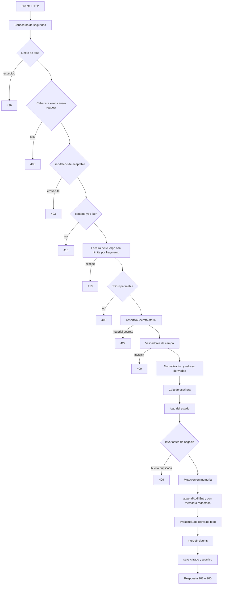
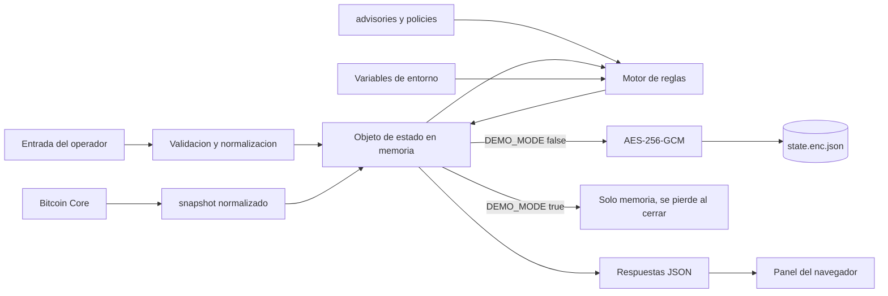

# 08 · Flujo de datos

De dónde viene cada dato, cómo se valida, en qué se transforma, dónde acaba y
quién puede verlo.

---

## 1 · Orígenes de datos

| Origen | Qué aporta | Confianza | Validación |
| --- | --- | --- | --- |
| Operador, por el panel o la API | Inventario, aprobaciones, eventos | **No confiable** — se valida todo | Guardia de secretos + validadores por campo |
| `config/advisories.json` | Matriz de avisos | Confiable, versionada | JSON válido, verificado por `validate-repo.js` |
| `config/policies.json` | Umbrales y política | Confiable, versionada | JSON válido |
| Bitcoin Core | Estado de la cadena | Semiconfiable | Allowlist, límite de 2 MiB, timeout |
| Entorno del proceso | Configuración | Confiable | Rangos recortados, defectos seguros |
| Estado en disco | Todo lo anterior, acumulado | Confiable **si el tag GCM verifica** | Autenticación AEAD |

> **El único dato que entra sin validar es la configuración**, y aun así todo
> valor numérico se recorta a su rango. La entrada del operador es la que recibe
> el tratamiento más severo, porque es la única superficie realmente abierta.

---

## 2 · Recorrido completo de una petición de escritura



**En palabras:** nueve puertas antes de que un dato toque el estado, y cada una
rechaza por una razón distinta y con un código distinto. Las seis primeras son
de transporte y forma; la séptima es la que define el producto —el rechazo de
material secreto—; las dos últimas son de dominio. Solo si todas se superan
entra el dato, y entonces se anota, se reevalúa todo y se guarda cifrado.

---

## 3 · Transformaciones aplicadas a la entrada

| Campo de entrada | Transformación | Resultado |
| --- | --- | --- |
| `fingerprint` | `trim()` + `toUpperCase()` + validación de 8 hex | `"a1b2c3d4"` → `"A1B2C3D4"` |
| `txid`, `approvalHash`, `hash` | `trim()` + `toLowerCase()` + validación de 64 hex | Normalizado a minúsculas |
| `name`, `label`, `vendor`, `model` | `trim()` + límite de longitud | Cadena acotada |
| `balanceSats`, `recordCount`, `valueSats` | `Number()` + `isSafeInteger` + rango | Entero seguro |
| `network`, `status`, `seedOrigin`, `walletType` | Pertenencia a un `Set` | Enum validado |
| `createdAt`, `expiresAt` | `new Date(...).toISOString()` | ISO-8601 normalizado |
| `tags` | `slice(0, 10)` + validación individual | Máximo 10 etiquetas |
| `spendsWatchedWallet` | `input !== false` | **Por defecto `true`** |
| `authorized` | `input === true` | **Por defecto `false`** |
| `quorum.independentVendors` | `new Set(vendors).size` | **Calculado, no aceptado** |
| `observedAt` | Ignorado si viene del cliente | **Siempre el reloj del servidor** |
| `id` | Ignorado si viene del cliente | **Siempre `crypto.randomUUID()`** |

> Los tres últimos son el mismo principio: **el cliente no controla la identidad
> ni el tiempo.** Aceptar un `observedAt` del cliente permitiría fabricar una
> ráfaga falsa o esconder una real fuera de la ventana de `BTC-TX-003`.

Nótese la asimetría deliberada de los booleanos: `spendsWatchedWallet` es
verdadero salvo negación explícita —ante la duda, se vigila— y `authorized` es
falso salvo afirmación explícita —ante la duda, es más grave—. Ambos fallan del
lado seguro.

---

## 4 · Dónde se almacena cada dato



**En palabras:** todo converge en un único objeto de estado en memoria. Ese
objeto se cifra y se escribe en disco, o se pierde al cerrar, según el modo. La
configuración y los avisos **no se guardan en el estado**: se leen al arrancar y
alimentan al motor desde fuera. Y lo que llega al navegador es siempre una
serialización de ese objeto, nunca un acceso directo.

---

## 5 · Qué consume cada componente

| Componente | Lee | Escribe |
| --- | --- | --- |
| `evaluateWallet` | `wallets`, `advisories`, umbral | Nada |
| `evaluateTransaction` | `observedTransactions`, `approvals` | Nada |
| `evaluateCorrelations` | Las cuatro colecciones anteriores | Nada |
| `evaluateNode` | `node` | Nada |
| `evaluateIntel` | `advisories`, `advisoryMaxAgeDays` | Nada |
| `evaluatePosture` | `wallets`, `config`, verificación de auditoría | Nada |
| `DefenseService` | Todo | **Todo** |
| `Watchtower` | Nada directamente | Vía `refreshNode` y `scan` |
| Panel del navegador | `summary`, `advisories` | Vía la API |

**Todo el dominio es de solo lectura.** Ninguna función de `src/domain/` muta su
entrada ni escribe nada. Es lo que hace que las reglas sean comprobables sin
montar infraestructura, y lo que permite que las 64 pruebas corran en segundos.

---

## 6 · Qué sale hacia fuera

| Destino | Qué se envía | Cuándo |
| --- | --- | --- |
| Bitcoin Core | 4 llamadas JSON-RPC de lectura, sin parámetros | Solo si se configura y se pide |
| `raw.githubusercontent.com` | Petición GET de la base del Security WG | **Solo** al ejecutar `check-runtime-advisories.js` |
| `nodejs.org` | Descarga del runtime y sus checksums | **Solo** al empaquetar |
| Navegador local | Respuestas JSON por loopback | En uso normal |
| `stdout` / `stderr` | Líneas JSON de log | Arranque, errores 5xx, fallos del watchtower |
| Disco | Estado cifrado | Cada mutación, en modo persistente |

> **Ningún dato del inventario sale nunca de la máquina.** No hay telemetría, ni
> analítica, ni actualización automática, ni comprobación de versión. Las tres
> conexiones de red posibles son a un nodo local, a la base de vulnerabilidades
> —solo durante una auditoría manual— y a `nodejs.org` —solo al construir un
> paquete—. Las tres son verificables leyendo el código: `check-local-only.js`
> falla si aparece cualquier otro destino en el panel.

---

## 7 · Qué se presenta al usuario

| Vista del panel | Datos | Endpoint |
| --- | --- | --- |
| Resumen | Puntuación, conteos, totales, últimos 5 incidentes, nodo | `GET /api/summary` |
| Custodia | Wallets con firmantes, huellas, firmware y quorum | `GET /api/summary` |
| Incidentes | Tabla completa con severidad, causa raíz, entidad y estado | `GET /api/summary` |
| Inteligencia | Avisos con resumen, mitigación y fuentes | `GET /api/advisories` |
| Laboratorio | Selector de wallets y simulador de gasto | `GET /api/summary` |

El panel **no consume** `/api/audit`, `/api/posture`, `/api/policies` ni
`/api/incidents`. Están disponibles por API y los usan la auditoría de 14 etapas
y cualquier integración.

Todo dato que entra en el DOM pasa por `escapeHtml`, y toda URL de fuente por
`safeUrl`.

---

## 8 · Datos personales y sensibles

| Categoría | ¿Se procesa? | Nota |
| --- | --- | --- |
| Semillas y claves privadas | **Nunca** | Rechazadas con 422 en la frontera |
| Identificadores de dispositivo (huellas) | Sí | Cifrados en reposo, nunca salen |
| Saldos | Sí, **declarados por el usuario** | El sistema no los consulta en la cadena |
| Fabricante y modelo | Sí | Es exactamente el dato que permite el phishing dirigido de `BTC-PRIVACY-002` |
| `txid` | Sí | Enlaza con la cadena pública |
| Nombre del fabricante en eventos de privacidad | Sí | Cadena libre introducida por el operador |
| Etiqueta de actor | Sí | El patrón admite `@`, así que puede ser un correo |
| Direcciones Bitcoin | **No** | No hay ningún campo de dirección en todo el esquema |
| Descriptores o claves públicas extendidas | **No** | No existen en el modelo de datos |

> Que no haya direcciones ni descriptores es una decisión, no un descuido: son
> los datos con los que se reconstruye el historial de transacciones de una
> persona. El sistema trabaja con huellas, que identifican el dispositivo sin
> revelar el gasto.

---

## 9 · Ejemplo de flujo completo, sin datos reales

**Escenario:** se registra una wallet cuyo firmante coincide con un aviso.

**Entrada** — `POST /api/wallets` con `content-type: application/json` y
`x-rootcause-request: 1`:

```json
{
  "name": "Reserva de laboratorio",
  "fingerprint": "d15ea5ed",
  "walletType": "single-sig",
  "network": "signet",
  "balanceSats": 75000000,
  "quorum": { "required": 1, "total": 1 },
  "signers": [
    {
      "label": "Firmante de prueba",
      "fingerprint": "d15ea5ed",
      "vendor": "COLDCARD",
      "model": "Mk3",
      "firmwareAtSeedCreation": "4.1.9",
      "firmwareTrack": "standard",
      "seedOrigin": "device"
    }
  ]
}
```

**Transformación:** las dos huellas pasan a mayúsculas, se generan dos UUID, se
calcula `independentVendors: 1` y se sella `createdAt`.

**Evaluación:** `4.1.9` cae dentro del rango `4.0.1`–`4.1.9` que el aviso
`BTC-ADV-2026-COLDCARD-ENTROPY` declara para el modelo `Mk3` en canal
`standard`. Y `75000000` sats supera el umbral de `10000000`.

**Salida** — dos incidentes, más los que ya hubiera:

| Código | Severidad | Por qué |
| --- | --- | --- |
| `BTC-KEY-001` | critical | El firmware de creación coincide con un aviso activo |
| `BTC-CUSTODY-001` | critical | Alto valor concentrado en una sola clave |

**Efectos secundarios:** dos entradas de auditoría —`wallet_registered` y
`auto_rescan`—, la puntuación de riesgo sube a 100, y el estado se reescribe
cifrado.

**Qué habría pasado con material secreto:** si esa misma carga hubiera incluido
`"seed"`, `"mnemonic"`, `"passphrase"` o una cadena con forma de `xprv` en
cualquier campo y a cualquier profundidad, la respuesta habría sido
`422 SECRET_MATERIAL_REJECTED` **antes de tocar el estado**, y nada se habría
escrito ni registrado.

---

## 10 · Dónde pueden producirse errores o inconsistencias

| Punto | Riesgo | Mitigación existente | Hueco |
| --- | --- | --- | --- |
| Entrada del operador | Procedencia declarada incorrecta | Ninguna posible | 🔴 **El sistema no puede verificar lo que se le declara.** Es la limitación de fondo del producto |
| `walletId` en un gasto observado | Referencia a wallet inexistente | Ninguna | 🟡 `BTC-TX-002` se salta el evento en silencio |
| Reloj del sistema | Marcas de tiempo incorrectas | Ninguna | 🟡 Afecta a `BTC-TX-003` y a `BTC-INTEL-001` |
| Matriz de avisos desactualizada | Falso negativo | `BTC-INTEL-001` avisa | 🟢 Cubierto |
| Dos procesos, mismo `DATA_DIR` | Pérdida de escrituras | Ninguna | 🔴 No soportado |
| Archivo de estado corrupto | Pérdida total | El arranque **falla** en vez de continuar vacío | 🟢 Falla ruidosamente |
| Nodo desincronizado | Observación incompleta | `BTC-NODE-002` | 🟢 Cubierto |
| Nodo caído | Ceguera | `BTC-NODE-001` | 🟢 Cubierto |
| Registro de auditoría manipulado | Historial falso | `verifyAuditChain` + `BTC-OPSEC-008` | 🟢 Detectable |
| Puerto expuesto | Inventario visible y modificable | `BTC-OPSEC-001` | 🟡 Detecta, no impide |

---

## 11 · Ciclo de vida de un dato

| Fase | Wallet | Incidente | Entrada de auditoría |
| --- | --- | --- | --- |
| Nace | `POST /api/wallets` | Cuando una regla se cumple | Con cada acción |
| Se actualiza | **Nunca.** No hay endpoint de edición | `mergeIncidents` en cada análisis | **Nunca.** Es inmutable por diseño |
| Se resuelve | — | Cuando la condición deja de darse | — |
| Se borra | **Nunca.** No hay endpoint de borrado | **Nunca.** Solo cambia de estado | **Nunca** |
| Caduca | — | — | — |

> **Nada se borra nunca.** Ni wallets, ni incidentes, ni eventos, ni entradas de
> auditoría. Es coherente con un producto de respuesta a incidentes —el
> historial es evidencia— y significa que el archivo de estado solo crece.
> Consecuencias en [`15-risks-and-technical-debt.md`](15-risks-and-technical-debt.md).

---

| Siguiente | |
| --- | --- |
| El contrato HTTP y las integraciones | [`09-apis-and-integrations.md`](09-apis-and-integrations.md) |
| Volver al índice | [`README.md`](README.md) |
