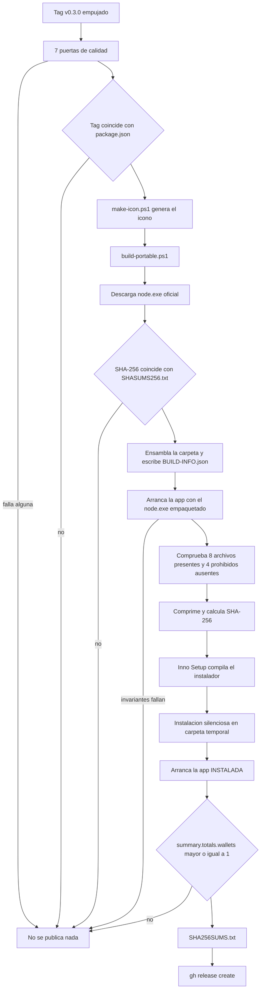

# 13 · Despliegue y operación

Cómo se construye, se publica y se opera el sistema, y qué se verifica en cada
paso antes de dejarlo pasar.

---

## 1 · Entornos

| Entorno | Cómo se ejecuta | Persistencia | Uso previsto |
| --- | --- | --- | --- |
| Desarrollo | `node src/server.js` o `pnpm dev` | Memoria | Trabajar en el código |
| CI | Runners de GitHub, puerto 0 | Memoria | Validación automática |
| Escritorio Windows | Instalador o portable | Cifrada en `%LOCALAPPDATA%` | **El destino principal** |
| Contenedor | `docker compose up` | Volumen `rootcause-data` | Servidor casero endurecido |
| Auditoría | `node scripts/audit-bitcoin.js --report` | Lee lo que haya | Informe puntual o semanal |

**No hay entorno de staging ni de producción alojada.** No los hay porque el
producto es local por diseño: alojarlo invalidaría su modelo de seguridad.

---

## 2 · Los cinco workflows

| Workflow | Cuándo | Qué hace |
| --- | --- | --- |
| `ci.yml` | push a `main`, PR, manual | 5 trabajos de validación |
| `security-audit.yml` | push, PR, **lunes 07:23 UTC**, manual | 6 trabajos de auditoría |
| `codeql.yml` | push, PR, **lunes 06:17 UTC**, manual | Análisis estático `security-extended` |
| `release-windows.yml` | **tag `v*`**, manual | Empaquetar, verificar y publicar |
| `deploy-landing.yml` | cambios en `landing/`, manual | Publicar en GitHub Pages |

**Rasgos comunes a los cinco:**

| Rasgo | Por qué |
| --- | --- |
| Actions pinneadas a **commit SHA** | Una etiqueta se puede mover; un SHA no |
| `permissions: contents: read` por defecto | Se eleva solo en el trabajo que lo necesita |
| `persist-credentials: false` en cada checkout | Nada de lo que corre después necesita empujar |
| `concurrency` con cancelación | Salvo en el release, donde `cancel-in-progress: false` |
| `timeout-minutes` explícito | Entre 10 y 30 |
| **Sin `npm ci` ni `pnpm install`** | El proyecto no tiene dependencias: CI nunca toca un registro de paquetes |

> Los dos trabajos programados corren en **minutos poco redondos** (07:23 y
> 06:17) para repartir la carga de los runners. Y corren **cada lunes** porque el
> mundo cambia aunque el repositorio no: un aviso nuevo de Node o de un
> fabricante no espera a que alguien haga commit.

---

## 3 · Proceso de construcción



**En palabras:** un tag no publica nada hasta pasar siete puertas de calidad y
comprobar que su número coincide con el manifiesto. Después se descarga el
runtime oficial y **se verifica su hash contra el archivo de checksums de
nodejs.org**; si no coincide, el proceso aborta. La aplicación se arranca con ese
runtime concreto y debe superar los 20 invariantes de seguridad. Se comprueba que
ocho archivos obligatorios estén dentro y que cuatro prohibidos —`data`,
`node_modules`, `.env`, `.git`— no lo estén. Se comprime, se compila el
instalador, **se instala en silencio de verdad** y se arranca la aplicación
instalada para comprobar que responde y que **tiene inventario**. Solo entonces
se generan los checksums y se crea el release con `gh`.

> **El paso que rara vez se ve en otros proyectos:** verificar que la aplicación
> instalada arranca **con contenido**. Un binario puede compilar, pesar lo
> esperado, instalarse sin errores y abrir vacío porque los datos nunca llegaron
> a empaquetarse. Eso solo se descubre ejecutándolo.

---

## 4 · Artefactos publicados

| Artefacto | Contenido |
| --- | --- |
| `RootCause-Bitcoin-Defense-<v>-win-x64-setup.exe` | Instalador por usuario, sin UAC |
| `RootCause-Bitcoin-Defense-<v>-win-x64-portable.zip` | Carpeta autocontenida con `node.exe` |
| `SHA256SUMS.txt` | Hashes de los dos anteriores |

Dentro del paquete viaja `BUILD-INFO.json` con la procedencia completa:

| Campo | Contenido |
| --- | --- |
| `product`, `version`, `architecture` | Identificación |
| `nodeVersion`, `nodeArchive`, `nodeSha256` | **Qué runtime exacto viaja dentro y con qué hash** |
| `runtimeSource` | URL oficial de descarga |
| `builtOnUtc` | Momento de construcción |
| `dependencies` | `"ninguna: la aplicacion no instala paquetes de terceros"` |

`check-runtime-advisories.js` **lee ese archivo** para auditar la versión de Node
que realmente se distribuyó, no la del runner de CI.

> 🟡 **Los artefactos no van firmados criptográficamente.** Se publican
> checksums, que protegen contra corrupción en tránsito pero no contra un
> repositorio comprometido. Registrado en
> [`15-risks-and-technical-debt.md`](15-risks-and-technical-debt.md).

---

## 5 · Instalación por usuario

El instalador Inno Setup usa `PrivilegesRequired=lowest`: **no pide UAC y no
toca Archivos de programa**.

| Elemento | Ruta |
| --- | --- |
| Programa | Carpeta elegida por el usuario |
| Datos | `%LOCALAPPDATA%\RootCause\bitcoin-defense\data` |
| Configuración | `%LOCALAPPDATA%\RootCause\bitcoin-defense\config.cmd` |
| Accesos directos | Menú inicio, y escritorio si se marca |

**Al desinstalar solo se borra `{app}\runtime`.** La carpeta de datos se conserva
a propósito: borrar estado cifrado sin preguntar sería una pérdida irreversible.

El instalador muestra, antes de instalar, un mensaje que dice explícitamente que
la aplicación es watch-only, que nunca pide semillas ni claves privadas y que no
firma ni envía transacciones.

---

## 6 · Despliegue en contenedor

| Ajuste del `compose.yaml` | Efecto |
| --- | --- |
| `ports: "127.0.0.1:8787:8787"` | **Publicado solo en loopback del host** |
| `read_only: true` | Sistema de archivos del contenedor de solo lectura |
| `tmpfs: /tmp` | Único punto escribible efímero |
| `cap_drop: [ALL]` | Sin ninguna capacidad de Linux |
| `security_opt: [no-new-privileges:true]` | Sin escalada |
| `volumes: rootcause-data` | Persistencia fuera de la imagen |
| `restart: unless-stopped` | Reinicio tras caída |
| `USER 1000:1000` (Dockerfile) | **Por UID numérico**, no por nombre: un host que no resuelva `node` acabaría ejecutando como root |
| `HEALTHCHECK` en forma JSON | **Sin `/bin/sh` interpuesto** entre Docker y el proceso |

Los dos últimos llevan su motivo escrito en el propio `Dockerfile`, con
referencia a la regla de `hadolint` que los exige.

> ⚠️ **`DEMO_MODE: "true"` en el compose de ejemplo.** El estado no persiste
> aunque haya volumen. Para uso real hay que fijar `DEMO_MODE=false` y aportar
> `ROOTCAUSE_DATA_KEY`.

---

## 7 · Publicación de la landing

`deploy-landing.yml` verifica, antes de desplegar, que la página no llame a
terceros:

| Comprobación | Qué busca |
| --- | --- |
| Atributo `src` remoto en `script`, `img`, `iframe`, `source`, `video`, `audio`, `embed` u `object` | Recursos externos |
| `<link href=https://...>` | Hojas de estilo o fuentes remotas |
| `@import` o `url(https://...)` en CSS | Importaciones remotas |
| `googletagmanager`, `google-analytics`, `hotjar`, `segment.io`, `plausible.io`, `matomo` | Analítica |

Se vigilan los **recursos que el navegador descarga**, no los enlaces: un
`<a href>` a GitHub es contenido; un `<script src>` a un CDN es un tercero
ejecutando código en la página.

---

## 8 · Logs

| Evento | Flujo | Formato |
| --- | --- | --- |
| Arranque | `stdout` | JSON con `address`, `mode`, `watchtower`, `browserOpened` |
| Error 5xx | `stderr` | JSON con `message` y `occurredAt` |
| Fallo del watchtower | `stderr` | JSON con `message` y `occurredAt` |
| Arranque fallido | `stderr` | JSON con `event: "startup_failed"` |

| Aspecto | Situación |
| --- | --- |
| Rotación | 🔴 No existe. Es el proceso quien escribe a la consola |
| Niveles | `info`, `error`, `fatal` |
| Correlación con `x-request-id` | 🟡 El identificador se emite en la respuesta pero **no se registra en el log** |
| Datos sensibles en el log | 🟢 No se registran cuerpos de petición ni valores del estado |
| En Windows | Los logs van a la ventana de consola del lanzador; **se pierden al cerrarla** |

---

## 9 · Métricas, monitoreo y alertas

| Elemento | Situación |
| --- | --- |
| Métricas | 🔴 No hay endpoint de métricas |
| Monitoreo externo | 🔴 No existe. Sería un canal de salida de datos |
| Alertas | 🟡 **Solo dentro del panel**: incidentes y puntuación de riesgo |
| Salud | 🟢 `GET /api/health`, usado por el `HEALTHCHECK` |
| Autoauditoría | 🟢 `GET /api/posture` y las 14 etapas |
| Alertas de CI | 🟢 Resumen en el job y artefacto de 90 días |

La ausencia de telemetría es intencionada y verificable: `check-local-only.js`
falla si aparece cualquier destino remoto en el panel.

---

## 10 · Respaldo y recuperación

| Aspecto | Procedimiento |
| --- | --- |
| Qué respaldar | `state.enc.json` **y**, por separado, la clave de datos |
| Cómo | Copia del archivo; la clave, en un gestor de contraseñas |
| Frecuencia | No hay automatismo; queda al operador |
| Restaurar | Colocar el archivo en `DATA_DIR` y arrancar con la misma clave |
| Sin la clave | 🔴 **Irrecuperable.** No hay puerta trasera |
| Verificar una restauración | `GET /api/audit` debe devolver `verification.valid: true` |

> El archivo **sin** la clave es inservible, y la clave **sin** el archivo
> también. Guardarlos en sitios distintos es justamente lo que hace que una copia
> robada no sirva de nada.

---

## 11 · Rollback

| Escenario | Procedimiento |
| --- | --- |
| Versión con un fallo | Descargar el release anterior desde GitHub Releases |
| Compatibilidad del estado | 🟢 Solo existe `schemaVersion: 1`; no hay migraciones que revertir |
| Rollback de la landing | Volver a desplegar desde el commit anterior |
| Rollback de un tag | Borrar el release y el tag; **el artefacto ya descargado no se puede retirar** |
| Rollback del estado | Restaurar la copia del archivo cifrado |

---

## 12 · Mantenimiento periódico

| Tarea | Frecuencia | Cómo |
| --- | --- | --- |
| **Verificar la matriz de avisos contra las fuentes oficiales** | Mensual o menos | Revisar cada fabricante del inventario y actualizar `verifiedAt` |
| Revisar el resultado de la auditoría semanal | Semanal | Resumen del job `security-audit` |
| Actualizar las actions propuestas por Dependabot | Semanal | PR agrupados |
| Republicar con un Node parcheado | Cuando `check-runtime-advisories.js` lo indique | `docs/RELEASE_CHECKLIST.md` |
| Verificar la cadena de auditoría | Al restaurar o ante sospecha | `GET /api/audit` |
| Ejecutar las 14 etapas | Ante cualquier cambio de inventario o configuración | `pnpm audit:bitcoin:report` |

> **La primera es la que más importa y la más fácil de descuidar.** Un panel en
> verde sobre una matriz de avisos sin revisar es una tranquilidad falsa. El
> producto avisa con `BTC-INTEL-001`, pero actualizar `verifiedAt` sin haber
> contrastado de verdad silencia el aviso sin mejorar nada.

---

## 13 · Publicar un release, paso a paso

Procedimiento completo con verificaciones en
[`../RELEASE_CHECKLIST.md`](../RELEASE_CHECKLIST.md). Resumen:

```bash
pnpm check
node scripts/check-history-secrets.js
node scripts/check-runtime-advisories.js
node scripts/audit-bitcoin.js --report
```

Después, actualizar la versión en **los dos sitios** —`package.json` y la cadena
`version` de `src/api/router.js`—, actualizar `CHANGELOG.md`, y crear el tag:

```bash
git tag v0.3.1
git push origin v0.3.1
```

El workflow hace el resto y **aborta si el tag no coincide con el manifiesto**.

---

## 14 · Qué hacer si el sistema detecta algo

Procedimiento operativo completo en [`../OPERACION.md`](../OPERACION.md) y, para
migrar fondos, en [`../RUNBOOK-MIGRATION.md`](../RUNBOOK-MIGRATION.md).

Lo esencial, por si se lee solo esto:

| Ante | Primero | **Nunca** |
| --- | --- | --- |
| `BTC-KEY-001` | Dejar de emitir direcciones de recepción en esa wallet | Actualizar el firmware creyendo que repara la semilla: **no la repara** |
| `BTC-TX-001`, `-002`, `-003` | Preservar evidencia y cortar autorizaciones automáticas | Esperar a que termine la ráfaga |
| `BTC-OPSEC-008` | **Preservar el archivo actual: es evidencia** | Sobrescribirlo o «arreglarlo» |
| Cualquier migración | Verificar huella y dirección en la pantalla del dispositivo | Verificarlas en la pantalla del ordenador |
| Cualquier comunicación urgente de un fabricante | Abrir tú el canal oficial | Seguir un enlace recibido; **ningún fabricante pide la frase de recuperación** |

---

| Siguiente | |
| --- | --- |
| Diagnóstico de problemas | [`14-troubleshooting.md`](14-troubleshooting.md) |
| Volver al índice | [`README.md`](README.md) |
